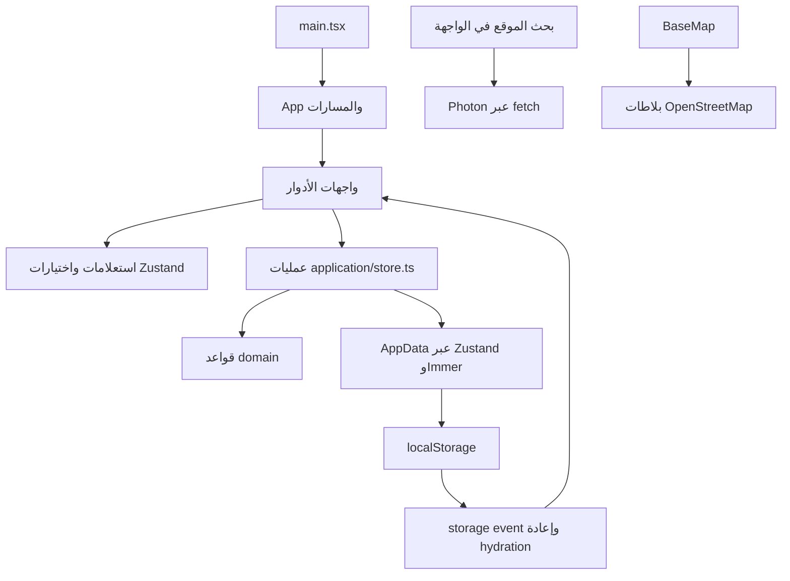
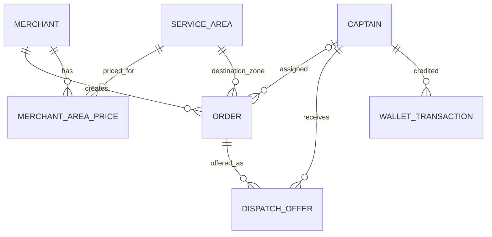
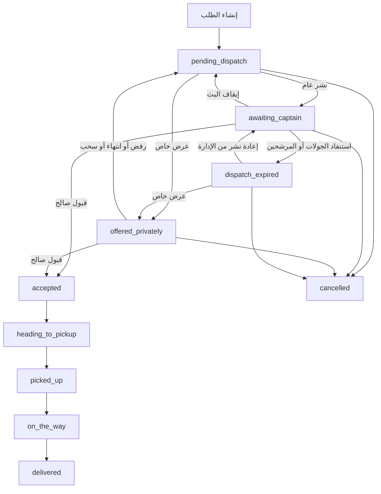

# شهم SHAHM — التوثيق الشامل للمشروع

> تاريخ المراجعة: **6 نوفمبر 2026** — الفرع: `Yousef-Hamdan` — آخر commit عند المراجعة: `8c12ea6`.
> يصف هذا المستند ملفات العمل الحالية، بما فيها تعديل `tsconfig.json` المحلي. الإصدار المعلن في `package.json` هو `0.1.0`.
> **حالة المنتج: نموذج تفاعلي تجريبي يعمل في المتصفح؛ ليس نظام تشغيل إنتاجيًا متعدد المستخدمين.**

## فهرس المحتويات

1. [نطاق المراجعة وطريقة قراءة الوثيقة](#scope)
2. [فكرة المشروع والأدوار](#product)
3. [التقنيات والإعدادات](#stack)
4. [التشغيل والبناء والتصحيح](#run)
5. [المعمارية وتدفق البيانات](#architecture)
6. [التخزين والجلسات والمزامنة](#storage)
7. [المسارات والشاشات](#routes)
8. [تفاصيل لوحة الإدارة](#admin)
9. [بوابة التاجر](#merchant)
10. [واجهة الكابتن](#captain)
11. [نموذج البيانات](#data)
12. [التسعير والمناطق والحدود](#pricing)
13. [إنشاء الطلب ودورة حياته](#orders)
14. [التوزيع وأهلية الكباتن](#dispatch)
15. [الموقع والخرائط والبحث](#maps)
16. [المحفظة والعمولة](#wallet)
17. [واجهات العمليات الداخلية](#actions)
18. [المكونات المشتركة والهوية والوصول](#ui)
19. [البيانات التجريبية وأدوات العرض](#demo)
20. [الاختبارات والتحقق](#tests)
21. [الملاحظات الفنية والحدود الحالية](#findings)
22. [القرارات المفتوحة وخطوات الانتقال للإنتاج](#production)
23. [دليل تعديل المشروع](#maintenance)
24. [فهرس ملفات المصدر](#files)
25. [بقية ملفات المستودع والمراجع](#references)

<a id="scope"></a>
## 1. نطاق المراجعة وطريقة قراءة الوثيقة

المراجعة مبنية على كود المشروع في `src/`، الاختبارات في `tests/`، إعدادات التشغيل والبناء، `README.md`، تعليمات `CLAUDE.md`، وعقد المحفظة الموجود في `docs/`. جرى تتبّع نقاط الدخول والمسارات والعمليات التي تستدعيها الواجهات، مع تشغيل البناء والاختبارات.

| بند | العدد وقت المراجعة |
|---|---:|
| ملفات المصدر داخل `src` | 140 |
| ملفات TSX | 104 |
| ملفات TypeScript | 33 |
| ملفات CSS | 3 |
| أسطر المصدر، شاملة التعليقات والأسطر الفارغة | 9,393 |
| أسطر ملفات الاختبار الثلاثة | 263 |
| فحوص قواعد العمل الناجحة | 105 |

لا تُعامل ملفات `node_modules/` أو `dist/` بوصفها كود أعمال مكتوبًا للمشروع؛ الأولى تبعيات والثانية مخرجات بناء. توجد أيضًا ملفات إرشادية لمساعدي البرمجة في `.claude/`، وهي ليست جزءًا من التطبيق الذي يشغّله المستخدم.

تستخدم الوثيقة التمييز الآتي:

- **منفّذ:** موجود في الكود الحالي، وقد يظل جزءًا من محاكاة محلية.
- **محاكاة:** سلوك عرض يعمل داخل المتصفح ولا يمثّل خدمة تشغيل فعلية.
- **مؤجّل أو مقترح:** ورد في التعليقات أو وثيقة العقد، لكنه غير منفّذ.
- **ملاحظة مراجعة:** استنتاج من قراءة الكود، وليس نتيجة اختبار شامل للواجهة أو تدقيق أمني مستقل.

المستودع يحيل إلى `SHAHM-SRS-001 v1.0`، وتحديثات `FU-1.2`، وطلب التغيير `CR v1.3`، ومواصفة التسعير حسب المنطقة. النصوص الأصلية الكاملة لهذه الوثائق ليست ضمن الملفات الظاهرة التي تمت مراجعتها؛ لذلك لا يُدّعى هنا التحقق من المطابقة الكاملة لها. عند اختلاف تعليق قديم مع التنفيذ، تشرح هذه الوثيقة السلوك الذي ينفّذه الكود وتذكر الاختلاف.

<a id="product"></a>
## 2. فكرة المشروع والأدوار

شهم منصة لتنسيق توصيل طلبات التجار بواسطة الكباتن. التاجر يطلب كابتنًا، والإدارة تضبط التغطية والأسعار وتتابع التشغيل، والكابتن يقبل العرض وينفّذ مراحل التوصيل.

| الدور | المسؤوليات الظاهرة في النموذج |
|---|---|
| الإدارة `admin` | التجار، الكباتن، المناطق، التسعير، التوزيع العام والخاص، متابعة الطلبات، شحن المحافظ، الدعم والإعدادات |
| التاجر `merchant` | إنشاء طلب توصيل، متابعة طلباته، مراجعة سجله وأسعاره وملفه، الوصول إلى الدعم |
| الكابتن `captain` | ضبط التوفر، قبول العروض أو رفضها، تحديث مراحل التوصيل، مراجعة السجل والمحفظة والدعم |
| النظام `system` | انتهاء مهلة العروض، بدء جولات لاحقة، تسجيل أحداث المحاكاة والتنبيهات |

العميل النهائي ليس حسابًا مستقلًا في هذا المستودع. اسمه ورقم هاتفه، إن أُدخلا، معلومات ضمن طلب التوصيل. لا توجد واجهة عميل ولا عملية تسجيل ذاتي للتجار أو الكباتن.

واجهة الكابتن المعروضة هي شاشة ويب داخل إطار هاتف. لا توجد هنا حزمة Android أو iOS، ولا خدمة تتبع موقع خلفية على الهاتف.

### حدود الصلاحيات الحالية

حارس `RequireSession` يوجّه المستخدم إلى شاشات دوره. وتصفّي الواجهات الطلبات بحسب حساب التاجر أو الكابتن. هذه **قيود واجهة تجريبية**: كامل البيانات محفوظ في المتصفح، وعمليات المخزن لا تنفّذ تفويضًا خادميًا. لا يجوز اعتبارها عزلًا أمنيًا للإنتاج.

<a id="stack"></a>
## 3. التقنيات والإعدادات

### 3.1 التبعيات الأساسية المثبّتة في البيان

| التقنية | الإصدار | الوظيفة |
|---|---|---|
| React / React DOM | 18.3.1 | المكونات ودورة العرض وتركيب التطبيق |
| React Router DOM | 7.18.5 | التنقل والمسارات وحماية الشاشات على مستوى الواجهة |
| Zustand | 4.5.5 | مخزن البيانات والجلسة والتنبيهات المؤقتة |
| Immer | 10.1.1 | تحديث الحالة بصيغة تعديلات على مسودة |
| Leaflet | 1.9.4 | الخرائط والعلامات والمضلعات |
| React Leaflet | 4.2.1 | دمج Leaflet مع React |
| Lucide React | 0.460.0 | الأيقونات |
| clsx | 2.1.1 | تركيب أسماء CSS الشرطية |
| TypeScript | 5.6.3 | فحص الأنواع |
| Vite | 6.4.5 | خادم التطوير والبناء |
| Vite React plugin | 4.7.0 | تحويل React ودعم التطوير |
| Tailwind CSS | 3.4.15 | التنسيق وألوان الهوية |
| PostCSS | 8.5.32 | معالجة CSS |
| Autoprefixer | 10.4.20 | بادئات CSS |

توجد تعريفات أنواع React وReact DOM وLeaflet ضمن `devDependencies`. تفاصيل التبعيات الانتقالية وإصداراتها الدقيقة محفوظة في `package-lock.json`.

### 3.2 ملفات الإعداد

| الملف | المسؤولية |
|---|---|
| `package.json` | اسم المشروع وإصداره وأوامر npm والتبعيات ومتطلب Node |
| `package-lock.json` | تثبيت شجرة التبعيات لإعادة التثبيت بشكل قابل للتكرار |
| `tsconfig.json` | فحص `src` و`tests`، وضع `strict`، دقة المسارات، وعدم إصدار JavaScript من tsc |
| `vite.config.ts` | تفعيل React وتعريف الاختصار `@` إلى `src` |
| `tailwind.config.js` | ألوان الهوية، الخط، الظلال، حركات الدخول، ومواقع البحث عن الأصناف |
| `postcss.config.js` | Tailwind وAutoprefixer |
| `vercel.json` | بناء Vite، نشر `dist`، وإعادة توجيه المسارات إلى `index.html` |
| `index.html` | الجذر، اللغة العربية، اتجاه RTL، العنوان، favicon، وتحميل خط Tajawal |
| `.vscode/launch.json` | فتح Chrome على `localhost:5173` للتصحيح |

### 3.3 إعداد TypeScript الحالي

الهدف `ES2020`، والوحدات `ESNext`، وحل الوحدات `bundler`، وJSX بنمط `react-jsx`. الخيارات تشمل `strict` و`isolatedModules` و`noEmit` و`noFallthroughCasesInSwitch` و`resolveJsonModule`.

تعريف المسارات بعد الإصلاح:

```json
"paths": { "@/*": ["./src/*"] }
```

لم يعد `baseUrl` موجودًا، ولم يُضَف `ignoreDeprecations`. لا يكفي تعريف الاختصار في TypeScript وحده للبناء، ولذلك يوجد التعريف المقابل في `vite.config.ts`.

<a id="run"></a>
## 4. التشغيل والبناء والتصحيح

### 4.1 المتطلبات والخطوات

المتطلب المعلن هو Node.js **20 أو أحدث**. استخدم الطرفية داخل مجلد المشروع:

```bash
npm ci
npm run dev
```

`npm ci` مناسب عندما تكون ملفات الحزمة والقفل متوافقة؛ أما عند تعديل التبعيات عمدًا فيُستخدم `npm install` لتحديث القفل. عنوان التطوير المعتاد:

```text
http://localhost:5173
```

اعتمد العنوان الذي يطبعه Vite فعليًا إذا كان المنفذ مشغولًا. أبقِ الطرفية التي تشغّل الخادم مفتوحة.

| الأمر | ما يفعله |
|---|---|
| `npm run dev` | يبدأ خادم التطوير |
| `npm run typecheck` | يشغّل `tsc --noEmit` |
| `npm run build` | يفحص الأنواع أولًا ثم يبني `dist` |
| `npm test` | يجمع اختبارات المنطق بواسطة esbuild ثم يشغّلها على Node |
| `npm run preview` | يعرض مخرجات البناء محليًا بعد تنفيذ build |

### 4.2 تسجيل الدخول التجريبي

| الحساب | اسم المستخدم | كلمة المرور |
|---|---|---|
| المدير التجريبي | `admin` | `admin1234` |
| التجار الستة | `merchant1` إلى `merchant6` | `demo1234` |
| الكباتن الثمانية | `captain1` إلى `captain8` | `demo1234` |

هذه بيانات عرض معلنة في كود المشروع، وليست أسرار إنتاج. بعض الحسابات غير مفعّلة أو غير مؤهلة عمدًا لاختبار الحالات المختلفة.

### 4.3 التصحيح من المحرّر

إعداد `.vscode/launch.json` يفتح المتصفح على المنفذ 5173؛ **لا يبدأ خادم npm**، إذ لا يحتوي على `preLaunchTask`. شغّل `npm run dev` أولًا ثم ابدأ جلسة التصحيح.

### 4.4 النشر

الإعداد الموجود لـVercel يبني بواسطة `npm run build` وينشر `dist`. إعادة كتابة جميع المسارات إلى `index.html` ضرورية لفتح مسار مثل `/admin/orders` مباشرة في تطبيق SPA.

النشر لا يضيف خادم أعمال أو قاعدة بيانات؛ سيظل كل متصفح يحتفظ ببياناته الخاصة. لا توجد متغيرات بيئة مخصصة لخادم أعمال أو مفاتيح خدمات في الإعداد الحالي.

### 4.5 تشخيص المشاكل الشائعة

| العرض | ما يجب التحقق منه |
|---|---|
| المتصفح لا يفتح الموقع | الخادم يعمل، والعنوان يطابق المنفذ المطبوع |
| F5 يفتح صفحة غير متاحة | ملف launch لا يشغّل الخادم تلقائيًا |
| الخريطة فارغة أو البحث يفشل | اتصال الإنترنت وطلبات بلاطات OSM وPhoton في Network |
| التاجر لا يستطيع إنشاء طلب | حالة حسابه، وأسعار مناطقه، وحدود المنطقة، ودبوس العميل، وقيمة الطلب |
| الكابتن لا يرى عروضًا | التوفر، حالة الحساب، الرصيد، وجود الموقع، وعدم وجود توصيل نشط |
| تبويبان لا يتزامنان | نفس المتصفح ونفس origin، بما فيه البروتوكول والمضيف والمنفذ |
| بيانات قديمة مستمرة بعد تغيير الكود | التخزين المحلي يبقى بعد التحديث؛ إعادة ضبط العرض تمسح تعديلات المستخدم التجريبية |
| تحذير `baseUrl` | الملف الحالي أزيل منه الخيار؛ تحقّق من حفظه ومن نسخة إعداد TypeScript التي يقرأها المحرّر |

<a id="architecture"></a>
## 5. المعمارية وتدفق البيانات

```text
src/
├── main.tsx              تركيب React والاستيرادات العامة
├── app/                 المسارات وتركيب القشرة العامة
├── domain/              الأنواع وقواعد العمل والحسابات الخالصة
├── application/         عمليات التطبيق، المخزن، الاستعلامات والجلسة
├── infrastructure/      البيانات الأولية ومزوّد بحث الأماكن
├── features/            واجهات الإدارة والتاجر والكابتن والدخول والدعم والعرض
└── shared/              المكونات والخرائط والتنسيق المشترك
```

الفصل الأساسي هو أن واجهة المستخدم تستدعي عملية، والعملية تطبق التحقق وتعدّل البيانات. لا تحسب الواجهة رسومًا جديدة مستقلة عن استعلامات طبقة التطبيق.



### نقطة الدخول

`src/main.tsx` يستورد CSS الخاص بـLeaflet وCSS العام، ثم يركّب `App` تحت `StrictMode`. داخل `App`:

1. تبدأ ساعة المحاكاة عبر `useSimulationClock`.
2. تُربط مزامنة التبويبات عبر `enableCrossTabSync`.
3. تُعرّف المسارات داخل `BrowserRouter`.
4. يضاف زر أدوات العرض و`Toaster` خارج فروع المسارات.

### العقد بين الواجهة والعمليات

معظم عمليات الأعمال ترجع:

```ts
type Result<T = undefined> =
  | { ok: true; value: T }
  | { ok: false; error: string; code?: string; currentFee?: number };
```

`reportResult` يعرض toast مناسبًا ويعيد نجاح العملية كقيمة منطقية. بعض عمليات العرض، مثل تعليم التنبيهات مقروءة أو تغيير إعدادات المحاكاة، ترجع `void`.

`run` داخل المخزن ينفّذ العملية ضمن تحديث Immer واحد ويعيد نتيجتها. هذا لا يحوّل التخزين المحلي إلى معاملة قاعدة بيانات، ولا يوفر قفلًا بين الأجهزة أو التبويبات.

<a id="storage"></a>
## 6. التخزين والجلسات والمزامنة

| المفتاح | الوسيط | المحتوى |
|---|---|---|
| `shahm-demo-v5` | `localStorage` | بيانات الأعمال والإعدادات وعدّاد الطلبات |
| `shahm-session` | `sessionStorage` | دور المستخدم ومعرّف الحساب في التبويب |
| `shahm-demo-tick-leader` | `localStorage` | معرّف تبويب المحاكاة القائد وتوقيت آخر نشاط |

المخزن يحفظ القوائم: `merchants`, `captains`, `areas`, `routes`, `prices`, `pricingAudit`, `orders`, `offers`, `walletTx`, `supportContacts`, `alerts`، إضافة إلى `settings`, `demo`, `seq`.

- لا تُحفظ دوال الإجراءات ضمن JSON؛ `partialize` يحدد البيانات فقط.
- مفتاح البيانات يحمل `v5`، بينما إصدار middleware المعلن `version: 1`؛ هذان شيئان مختلفان.
- لا يوجد مسار `migrate` لترحيل بيانات مستخدم حقيقية. تغيير المفتاح السابق جعل النموذج يبدأ بمجموعة بيانات جديدة.
- تغيير التخزين من تبويب آخر يولّد حدث `storage`، ويؤدي إلى `rehydrate`.
- الجلسة منفصلة لكل تبويب، مما يسمح بفتح الأدوار الثلاثة معًا.
- `useValidSession` يتحقق من وجود الحساب، لكنه لا يرفض الجلسة لمجرد أن الحساب غير نشط. تقييد بعض الأعمال يتم في العمليات، مثل منع التاجر المعطّل من إنشاء طلب.
- لا توجد مزامنة أجهزة أو حسابات سحابية أو نسخ احتياطية للبيانات.

### ساعة المحاكاة

تعمل كل ثانية. قبل تنفيذ `tick` يفحص التبويب سجل القيادة؛ إذا كان تبويب آخر حدّثه خلال 3 ثوانٍ، يتراجع هذا التبويب. وإلا يسجل نفسه قائدًا.

هذه آلية تقليل تعارض لعرض محلي وليست قفلًا موزعًا. تعليق المتصفح أو إغلاق التبويبات يؤثر في توقيت الجولات والحركة؛ لا توجد مهمة خادمية مستقلة تنفّذها عند غياب المتصفح.

<a id="routes"></a>
## 7. المسارات والشاشات

المصدر: [src/app/App.tsx](src/app/App.tsx).

| المسار | الشاشة أو السلوك | الدور |
|---|---|---|
| `/` | التحويل إلى صفحة الدور أو تسجيل الدخول | بحسب الجلسة |
| `/login` | تسجيل الدخول وحسابات العرض | غير مسجل؛ المسجل يعود إلى صفحته |
| `/admin` | لوحة التحكم | إدارة |
| `/admin/dispatch` | مركز التوزيع | إدارة |
| `/admin/map` | خريطة الكباتن | إدارة |
| `/admin/orders` | جميع الطلبات والفلاتر | إدارة |
| `/admin/merchants` | إدارة التجار | إدارة |
| `/admin/merchants/:merchantId/zones` | أسعار ومناطق تاجر، مع رجوع للتجار | إدارة |
| `/admin/captains` | إدارة الكباتن | إدارة |
| `/admin/areas` | المناطق والحدود ومسارات التوصيل | إدارة |
| `/admin/pricing` | بطاقات التجار للتسعير | إدارة |
| `/admin/pricing/:merchantId` | أسعار تاجر، مع رجوع لقائمة التسعير | إدارة |
| `/admin/wallets` | المحافظ والشحن والسجل | إدارة |
| `/admin/support` | قنوات الدعم | إدارة |
| `/admin/settings` | إعدادات الإدارة | إدارة |
| `/merchant` | إنشاء الطلب والمتابعة والسجل | تاجر |
| `/merchant/settings` | ملف التاجر وموقعه وأسعاره للقراءة | تاجر |
| `/captain` | واجهة الكابتن ذات التبويبات | كابتن |
| أي مسار غير مطابق | تحويل إلى `/` | الجميع |

معاملات URL المستخدمة:

- `?new=1` في التجار أو الكباتن يفتح نموذج الإضافة، ثم يُحذف المعامل من العنوان.
- `?captain=<id>` في المحافظ يفتح الشحن للكابتن المحدد.
- `?bg=original|aurora|silk|grid` يختار معاينة خلفية الدخول. شريط الاختيار يظهر في التطوير أو عند وجود المعامل.

<a id="admin"></a>
## 8. تفاصيل لوحة الإدارة

### 8.1 القشرة العامة

`AdminLayout` يحتوي على قائمة جانبية، قائمة متجاوبة للشاشات الصغيرة، حالة البث العام، قائمة تنبيهات، وتسجيل الخروج. عدّاد مركز التوزيع يجمع `pending_dispatch` و`dispatch_expired`.

قائمة التنبيهات تعرض آخر 25 تنبيهًا، وتطلب تعليم التنبيهات مقروءة بعد فتحها بنحو 1.5 ثانية. المخزن يحتفظ بحد أقصى 60 تنبيهًا.

### 8.2 لوحة التحكم

تحتوي على مفتاح البث و8 مؤشرات:

1. بانتظار التوزيع: حالات الطابور.
2. معروضة على الكباتن: العام والخاص.
3. توصيلات نشطة: القبول ومراحل التنفيذ قبل التسليم.
4. سُلّمت اليوم: بحسب بداية اليوم في توقيت متصفح التشغيل.
5. كباتن مؤهلون الآن، مع عدد المتاحين.
6. GPS متأخر أثناء التوصيل.
7. إجمالي التجار.
8. إجمالي الكباتن.

جدول أحدث الطلبات يعرض 8 طلبات مرتبة حسب **آخر تحديث**، مع التفاصيل والإلغاء عندما تسمح الحالة. أسفله آخر 12 تنبيهًا تشغيليًا. لا توجد مؤشرات معتمدة لزمن الإسناد أو نسبة القبول.

### 8.3 مركز التوزيع

يفصل بين الطلبات المنتظرة، الطلبات التي استنفدت التوزيع وتحتاج تدخلًا، والعروض القائمة. يبيّن رقم الجولة ومهلة الرد واستجابة كل كابتن والمسافة التقريبية. الإجراءات المتاحة بحسب الحالة: نشر عام، إسناد خاص، إلغاء.

الإسناد الخاص يرتب الكباتن المؤهلين أولًا ثم حسب القرب، ويعرض سبب عدم الأهلية. لا يوجد تجاوز إداري لقيد الأهلية في العملية الحالية.

### 8.4 الخريطة الحية

تعرض علامات الكباتن فقط. الفلاتر: الكل، المتصلون، المشغولون، المتاحون، GPS متأخر، وغير المتاحين؛ مع البحث بالاسم. «متصل» يعني متاحًا أو في توصيل وفق بيانات النموذج، وليس اتصال جهاز حقيقي.

الضغط على الكابتن يفتح معلومات الحساب والمركبة والهاتف والتوصيل الحالي وآخر تحديث للموقع. الكابتن بلا موقع يظهر في القائمة لكنه لا يملك علامة على الخريطة.

### 8.5 الطلبات

بحث بالمرجع واسم العميل وهاتفه ووصف الوجهة، وفلاتر للحالة والتاجر والكابتن والمنطقة. الصفحة تعرض 12 طلبًا في كل مرة، مرتبة حسب الإنشاء تنازليًا.

درج التفاصيل يحتوي خريطة الاستلام والوجهة والكابتن أثناء الرحلة، رسومًا محفوظة، قيمة الطلب، بيانات العميل، محاولات التوزيع، وسجل تغيّر الحالات. الخط المرسوم بين النقطتين مستقيم ولا يمثل طريق قيادة محسوبًا.

### 8.6 التجار

إضافة وتعديل، بحث بالاسم والهاتف والعنوان وجهة الاتصال، تصفية بفئة النشاط، عرض التفاصيل، تفعيل أو تعطيل، والانتقال إلى التسعير. إنشاء تاجر جديد يوجّه الإدارة مباشرة لإعداد مناطقه وأسعاره.

الحقول: اسم النشاط، الفئة، جهة الاتصال، الهاتف، المدينة، المنطقة، نقطة الاستلام، وبيانات دخول تجريبية. تعديل التاجر القديم بلا مدينة أو منطقة يسمح بالحفاظ على موقعه القديم ما دام لم يتغير؛ عند تغييره يجب استكمال الهيكل الجديد.

### 8.7 الكباتن

إضافة وتعديل حسابات، عرض التوفر والأهلية والموقع والرصيد والتوصيلات المكتملة. درج التفاصيل يحتوي التفعيل والتقييم الداخلي والملاحظات وسجلًا مختصرًا للتوصيلات ورابط شحن المحفظة.

الكابتن الجديد يبدأ `active` لكن `offline`، بدون موقع وبدون قيد رصيد. لذلك إنشاؤه وحده لا يجعله مؤهلًا. لا يُسمح بتعطيل كابتن لديه توصيل نشط. التقييم بخمس نجوم داخلي وتجريبي.

### 8.8 المناطق والأسعار والمحافظ والدعم

المناطق تدير السجل المركزي والحدود؛ التسعير يحدد رسمًا مستقلًا لكل تاجر ومنطقة. المحافظ تعرض الأهلية وسجل الشحن. الدعم يدير الهاتف وواتساب والبريد وقنوات أخرى، مع الترتيب والإخفاء والحذف والمعاينة.

إعدادات الإدارة تجمع البث ومعلومات التوزيع والعمولة والمناطق والدعم والفئات والحساب واللغة والإصدار. معظمها للقراءة أو روابط للشاشة المالكة، وليس نموذج إعدادات شاملًا قابلًا للحفظ.

<a id="merchant"></a>
## 9. بوابة التاجر

### إنشاء طلب

1. يظهر موقع الاستلام من ملف التاجر تلقائيًا.
2. يدخل التاجر اسم العميل وهاتفه اختياريًا.
3. يحدد دبوس العميل بالبحث أو بالنقر والسحب على الخريطة.
4. يُستنتج نطاق التوصيل والسعر الثابت من الدبوس.
5. يدخل قيمة الطلب المطلوبة بالدينار، بحد أقصى ثلاث خانات عشرية.
6. يراجع البيانات والرسوم في نافذة التأكيد.
7. عند التأكيد يُعاد حساب الرسوم والتحقق من الشروط داخل المخزن.
8. عند النجاح تظهر رسالة ومرجع `SH-...` ويُفرّغ النموذج.

اختيار **منطقة** من قائمة البحث لا يحدد عميلًا: ينقل مركز الخريطة ويطلب دبوسًا دقيقًا. أما اختيار **مكان** من نتائج Photon فيضع إحداثياته. تحريك الدبوس يدويًا يلغي اسم المكان المختار سابقًا حتى لا تبقى تسمية مضللة.

يُحجب النموذج عن الحساب المعطّل أو التاجر بلا مناطق مسعّرة ومفعّلة. وجود أسعار وحده لا يكفي لنجاح طلب إذا كانت المنطقة بلا مضلع يمكن مطابقته.

### المتابعة والإعدادات

تعرض الطلبات الحالية كل حالة ليست `delivered` أو `cancelled`، بما فيها طلبات الطابور. يظهر الكابتن ورابط الاتصال به أثناء التوصيل النشط. السجل يتيح الكل أو المسلّمة أو الملغاة.

صفحة الإعدادات تعرض الملف التجاري والفئة وموقع الاستلام والأسعار والحساب والدعم للقراءة فقط. لا يستطيع التاجر تعديل الأسعار أو الموقع أو فئته. لا توجد عملية إلغاء طلب من واجهته.

<a id="captain"></a>
## 10. واجهة الكابتن

| التبويب | الوظيفة |
|---|---|
| الطلبات | العروض غير المنتهية لهذا الكابتن، الرسوم، المهلة، الاستلام والوجهة، قبول أو رفض |
| التوصيل | الطلب النشط، المراحل، الخريطة، الاتصالات، الاتجاهات، وتأكـيد التسليم |
| السجل | الطلبات النهائية المسندة إليه مع فلتر الحالة |
| المحفظة | رصيد مشتق من القيود وسجل الشحن وحد الأهلية |
| حسابي | بياناته ومركبته وقنوات الدعم |

عندما يوجد طلب نشط وتبويب العروض مختار، تعرض الواجهة التوصيل تلقائيًا. لا يسمح المخزن بالتحول إلى غير متاح أثناء رحلة نشطة.

مراحل التنفيذ تتطلب فعلًا صريحًا من الكابتن. الوصول الافتراضي إلى النقطة في المحاكاة لا يسلّم الطلب تلقائيًا. التسليم النهائي يفتح تأكيدًا؛ لا يتطلب OTP أو صورة أو توقيعًا.

الاتجاهات إلى الاستلام تستخدم إحداثياته في Google Maps. الوجهة الحديثة تستخدم الدبوس الدقيق؛ الوجهة القديمة التقريبية تستخدم بحثًا نصيًا. رابط خارجي لا يعني تكامل SDK أو احتساب طريق داخل شهم.

<a id="data"></a>
## 11. نموذج البيانات

المصدر المرجعي للأنواع: [src/domain/types.ts](src/domain/types.ts)، وتجميعها: [src/infrastructure/seed.ts](src/infrastructure/seed.ts).

| الكيان | الحقول الرئيسية | العلاقة أو الغرض |
|---|---|---|
| `Merchant` | `id`, `businessName`, `category`, `contactName`, `phone`, `cityId`, `areaId`, `pickup`, `address`, `status`, بيانات الدخول، `createdAt` | صاحب الطلب ونقطة الاستلام |
| `Captain` | `id`, `fullName`, `phone`, `vehicleType`, `vehicleDescription`, `status`, `availability`, `lastLocation`, `gpsSignal`, `rating`, `adminNotes`, بيانات الدخول | منفّذ التوصيل |
| `CaptainLocation` | `position`, `recordedAt`, `source`, `activeOrderId?` | الموقع وسبب اعتباره حديثًا أو تجريبيًا |
| `ServiceArea` | `id`, `governorateId`, `cityId`, `name`, `aliases`, `polygon`, `status`, `notes`, توقيتات الإنشاء والتحديث | منطقة مركزية قابلة للتسعير |
| `DeliveryRoute` | `originAreaId`, `destinationAreaId`, `governorateId`, `status` | سجل اتجاه من منطقة إلى أخرى؛ لا يدخل في التسعير الحالي |
| `MerchantAreaPrice` | `merchantId`, `areaId`, `price`, `status`, `updatedAt`, `updatedBy` | رسم ثابت لزوج تاجر ومنطقة |
| `PricingCopyAudit` | المصدر والهدف وطريقة النسخ والتغييرات والفاعل والوقت | تسجيل عملية نسخ أسعار مع السابق واللاحق |
| `DeliveryOrder` | المرجع، التاجر، الاستلام، الوجهة، العميل، المنطقة، قيمة الطلب، الرسوم، الكابتن، الحالة، دورات التوزيع، سجل الحالة | سجل الطلب المركزي |
| `DispatchOffer` | `orderId`, `captainId`, `mode`, `round`, `attempt?`, `status`, المواعيد، المسافة، الرتبة | محاولة عرض على كابتن واحد |
| `WalletTransaction` | `captainId`, `type: recharge`, `amount`, `actor`, `reason`, `createdAt` | قيد شحن تجريبي |
| `SupportContact` | `channel`, `label`, `value`, `enabled`, `order` | قناة دعم مركزية |
| `OpsAlert` | `kind`, `message`, `orderId?`, `at`, `read` | تنبيه داخل النظام |
| `Session` | `role`, `id` | حساب التبويب |
| `PlatformSettings` | `publicBroadcast` | إعداد تشغيل عام واحد |
| `DemoSettings` | سياسة العروض، حجم المجموعة، المهلة الخاصة، حد الرصيد، تأخر الموقع، سرعة المحاكاة | افتراضات قابلة للعرض |

### حقول الطلب المهمة

- `pickup`: نسخة من موقع وعنوان الاستلام عند الإنشاء.
- `destination`: الاسم الظاهر وسياق المنطقة والإحداثيات؛ `approximate` يميّز بعض البيانات القديمة.
- `mealValue`: قيمة البضاعة/الطلب بالفلس، منفصلة عن رسوم التوصيل. اختيارية في النوع لدعم السجلات القديمة، مطلوبة عند إنشاء طلب جديد.
- `deliveryPrice` و`pricingSnapshotAt`: الرسم المحفوظ ووقت تثبيته.
- `areaName`: نسخة من الاسم لا تتغير بتغيير اسم المنطقة لاحقًا.
- `dispatchRound`: رقم دورة نشر عام أو إسناد خاص، وليس وحده رقم محاولة الـ60 ثانية.
- `dispatchAttempt`: المحاولة العامة داخل الدورة، حتى ثلاث محاولات.
- `queueReason`: سبب الحاجة إلى تدخل الإدارة.
- `history`: عناصر تحتوي الحالة السابقة والجديدة والفاعل والوقت وملاحظة اختيارية.
- `gpsStaleAlerted`: يمنع تكرار تنبيه انقطاع الموقع في كل tick.

### العلاقات



هذه علاقات منطقية في مصفوفات JavaScript، وليست جداول قاعدة بيانات منفّذة. المعرفات الجديدة مولّدة من الوقت ومقطع عشوائي، ومرجع الطلب من عدّاد محلي؛ لا توفر uniqueness عالميًا بين أجهزة منفصلة.

<a id="pricing"></a>
## 12. التسعير والمناطق والحدود

### 12.1 المال

`Money` اسم نوع لـ`number`، والقواعد تستخدم **الفلس الصحيح**: دينار واحد = 1000 فلس. `parseJodInput` يدعم الأرقام العربية والفاصل العشري العربي أو النقطة أو فاصلة، ويرفض النص غير المطابق لأرقام موجبة الصيغة حتى ثلاث خانات عشرية. العمليات نفسها ترفض الصفر عندما يشترط الرسم أو قيمة الطلب قيمة موجبة.

التنسيق بـ`ar-JO-u-nu-latn`، مع دقة حتى ثلاثة منازل. `formatMoneyExact` يعرض ثلاث منازل دائمًا مثل `0.200`.

### 12.2 تحديد الرسم

```text
دبوس العميل
  → المناطق النشطة ذات مضلع يحتوي النقطة
  → سعر نشط وموجب للتاجر في إحدى هذه المناطق
  → رسم ثابت محفوظ مع الطلب
```

`resolveZoneFee` يرجع `ok` أو `zone_unavailable` أو `no_price`. `resolveLocationFee` يضيف `outside` عند عدم وجود منطقة مطابقة.

**التداخل:** إذا احتوت عدة مناطق النقطة، يفوز أول نطاق في ترتيب البيانات له سعر صالح لهذا التاجر. لا يوجد ترجيح بالأصغر أو الأقرب، ولا رفض تلقائي للتداخل. قواعد النقاط الواقعة تمامًا على الحدود ما تزال مفتوحة.

لا تعتمد العملية التشغيلية على المسافة أو نوع المركبة أو فئة النشاط أو `DeliveryRoute`. هناك استخدام للمسافة في **توليد أسعار البيانات الأولية** فقط، ثم تُخزّن هذه الأسعار كقيم ثابتة؛ وهذا مختلف عن حساب رسوم الطلب وقت إنشائه.

### 12.3 تعديل الأسعار ونسخها

تعديل الرسم يؤثر في الطلبات الجديدة. الطلبات القديمة تحتفظ بنسختها. إذا تغيّر الرسم أثناء وجود نافذة مراجعة طلب مفتوحة، يعيد `createOrder` خطأ `fee_changed` مع الرسم الحالي، وتطلب الواجهة تأكيدًا جديدًا.

نسخ الأسعار بين تاجرين:

| النمط | السلوك |
|---|---|
| `fill_missing` | إضافة الصفوف الناقصة فقط، مع إبقاء السعر الموجود |
| `overwrite` | إضافة الناقص واستبدال الأسعار المختلفة؛ الواجهة تطلب تأكيدًا إضافيًا |

المعاينة تعرض `add`, `update`, `unchanged`, `kept`, `skipped`. تُتخطى المنطقة غير النشطة أو سعر المصدر المعطّل. لا تُنسخ هوية التاجر أو موقعه أو طلباته. إعادة العملية دون فرق تعيد `changed: 0` ولا تضيف سجل تدقيق جديدًا.

إذا كان صف الهدف موجودًا لكنه معطّل، تحديث قيمته لا يفعّله تلقائيًا؛ النسخ يحافظ على حالته. تعرض واجهة السجل ملخص النسخ، بينما بيانات التدقيق نفسها تحتفظ بالقيم السابقة واللاحقة لكل منطقة متغيّرة.

### 12.4 المناطق والجغرافيا

المحافظات المرجعية 12، والمدن المرجعية مدينة رئيسية واحدة لكل محافظة. القائمة بداية مقترحة وليست كتالوجًا رسميًا كاملًا. المناطق المخزّنة تحمل معرف المحافظة والمدينة، والأسماء البديلة للمساعدة في البحث ومنع التكرار.

منع التكرار يطبّع الاسم والأسماء البديلة، ويبحث على مستوى قائمة المناطق كلها، وليس داخل المحافظة وحدها. هذا قد يحتاج تغييرًا إذا أُضيفت مناطق متشابهة الاسم في مدن مختلفة.

محرر الحدود يفتح عند الطلب، وليس خريطة دائمة على صفحة المناطق. يدعم إضافة نقطة وسحبها والتراجع ومسح المسودة، ولا يكتب إلا عند حفظ الحدود. التحقق يرفض إحداثيات غير صالحة، وأقل من ثلاث نقاط مختلفة، والتقاطعات الصريحة التي يكتشفها فحص القطع.

لا توجد معالجة GIS كاملة: لا يتحقق الفحص الحالي من كل حالات الانحلال الهندسي أو تراكب الأضلاع أو مساحة المضلع، ولا يمنع تداخل منطقتين. زر مسح النقاط يمسح المسودة، لكنه لا يسمح بحفظ مضلع فارغ.

### 12.5 موقع التاجر والمسارات

التاجر الجديد يحتاج مدينة ومنطقة تابعة لها ودبوسًا صالحًا. إذا كان للمنطقة مضلع، يُرفض دبوس خارجها ولا يعاد إسناده بصمت. إذا لم تكن الحدود مرسومة، تسمح العملية بالموقع مع إظهار محدودية التحقق في الواجهة.

مسار التوصيل يجب أن يكون بين منطقتين مختلفتين في المحافظة نفسها، ولا يتكرر في الاتجاه نفسه. عكس الاتجاه سجل آخر ممكن. المسار لا يقيّد حاليًا `createOrder` ولا يحدد سعره. لا تُستخدم حالة المنطقة لرفض إنشاء المسار في الدالة الحالية.

<a id="orders"></a>
## 13. إنشاء الطلب ودورة حياته

### شروط الإنشاء

- التاجر موجود ونشط.
- الهاتف اختياري؛ إن أُدخل، يطابق عشرة أرقام بعد التطبيع.
- قيمة الطلب عدد صحيح موجب بالفلس.
- إحداثيات العميل صالحة.
- توجد منطقة نشطة مطابقة وسعر نشط موجب للتاجر.
- عند إرسال `expectedFee`، يجب أن يساوي الرسم الحالي.

بعد ذلك ينشئ المخزن المرجع والنسخ التاريخية، ويسجّل حدث الإنشاء وتنبيهًا. إذا كان البث مفعّلًا يبدأ التوزيع العام؛ وإلا يبقى الطلب `pending_dispatch`.

### الحالات

| الحالة | معناها |
|---|---|
| `pending_dispatch` | ينتظر إجراء التوزيع |
| `awaiting_captain` | عروض عامة قائمة أو دورة عامة قيد التنفيذ |
| `offered_privately` | عرض خاص لكابتن محدد |
| `dispatch_expired` | انتهت الجولات أو نفد المرشحون؛ يحتاج تدخل الإدارة |
| `accepted` | قبل الكابتن الطلب |
| `heading_to_pickup` | يتجه للاستلام |
| `picked_up` | استلم الطلب من التاجر |
| `on_the_way` | يتجه إلى العميل |
| `delivered` | اكتمل التسليم بتأكيد الكابتن |
| `cancelled` | ألغته الإدارة قبل القبول |



الإلغاء متاح للإدارة في حالات ما قبل القبول فقط، ويسحب العروض المعلقة ويسجل السبب أو سببًا افتراضيًا. لا يضيف أثرًا ماليًا. لا توجد عملية إعادة فتح طلب مُسلّم أو ملغى.

دالة `transition` نفسها أداة تسجيل وتحديث بسيطة؛ شرعية الانتقال تفرضها العمليات التي تستدعيها، وليست محرك آلة حالات منفصلًا يرفض كل انتقال غير قانوني تلقائيًا.

<a id="dispatch"></a>
## 14. التوزيع وأهلية الكباتن

### 14.1 شروط الأهلية

كل الشروط التالية مطلوبة:

1. الحساب `active`.
2. التوفر `available`.
3. لا يوجد توصيل نشط للكابتن.
4. الرصيد أكبر من صفر ويبلغ الحد التجريبي على الأقل.
5. يوجد `lastLocation` لترتيب القرب.

الحد الافتراضي 2000 فلس. وجود الموقع مطلوب، لكن **حداثته أو حالة GPS ليست شرط استبعاد مستقلًا في `evaluateEligibility`**. تُعرض حداثة الموقع بوضوح على الواجهة، لكن ترتيب المرشحين قد يستخدم موقعًا تجريبيًا أو آخر موقع محفوظ.

### 14.2 التوزيع العام

- مدة المحاولة 60 ثانية، وبحد أقصى 3 محاولات في الدورة.
- الافتراضي مجموعة من أقرب 3 كباتن؛ يمكن اختيار التسلسل فردًا فردًا لأغراض العرض.
- المسافة المستعملة Haversine بين الكابتن ونقطة استلام التاجر؛ ليست مسافة طريق أو ETA.
- الكابتن الذي عُرض عليه الطلب في الدورة لا يدخل دفعة أخرى من الدورة نفسها.
- انتهاء جميع عروض المحاولة بالرفض أو السحب يبدأ المحاولة التالية دون انتظار نهاية الدقيقة.
- نفاد المرشحين يعيد الطلب للإدارة ولو لم تكتمل ثلاث محاولات.
- بعد الحد الأقصى لا تبدأ محاولة رابعة تلقائيًا.
- إعادة نشر الإدارة تبدأ دورة جديدة ويمكن أن يعاد عرض الطلب على كباتن الدورات السابقة.

### 14.3 القبول والرفض والعرض الخاص

القبول يتحقق من ملكية العرض، وحالته المعلقة، وعدم انتهاء موعده، وعدم إسناد الطلب سابقًا، وأهلية الكابتن الحالية. ثم يربط الكابتن ويسحب بقية عروض **الطلب نفسه** ويبدأ تتبع الرحلة المحاكى.

لا يسحب القبول في الحال كل عروض الطلبات الأخرى الموجهة إلى هذا الكابتن؛ لكن محاولة قبولها تُرفض بسبب انشغاله، وتبقى خاضعة لمهلتها وآليات الحل الحالية.

العرض الخاص لا يعني إسنادًا نهائيًا بلا موافقة: يحتاج قبول الكابتن. مهلته الافتراضية 60 ثانية وقابلة للتعديل في أدوات العرض. عند الرفض أو الانتهاء يعود إلى `pending_dispatch`.

### 14.4 مفتاح البث

إيقاف البث يمنع النشر العام الجديد، ويسحب العروض العامة الحالية ويعيد طلباتها للطابور. لا يوقف الرحلات النشطة أو العروض الخاصة. إعادة التفعيل تشمل الطلبات الجديدة؛ لا تنشر تلقائيًا الطلبات المتراكمة في الطابور.

<a id="maps"></a>
## 15. الموقع والخرائط والبحث

### 15.1 الخدمات المستخدمة فعليًا

| الخدمة | الاستخدام | طبيعة الاتصال |
|---|---|---|
| OpenStreetMap tiles | خلفية الخرائط | طلبات صور بلاطات من المتصفح |
| Photon على `photon.komoot.io` | بحث أسماء الأماكن | `fetch` مباشر من المتصفح |
| Google Fonts | تحميل Tajawal | CSS وملفات خطوط خارجية |
| Google Maps | فتح اتجاهات أو بحث | انتقال خارجي بطلب المستخدم |
| `tel:` / `mailto:` / `wa.me` | التواصل من القنوات المضافة | فتح تطبيق أو رابط خارجي |

ليس كل ما يعرضه النموذج بيانات وهمية: **بحث الأماكن يجري على خدمة خارجية حقيقية**. أما الكباتن وبيانات الأعمال الأولية وحركتهم ومحافظهم فهي محاكاة. لا يوجد التقاط مباشر لـGPS الجهاز في الكود الحالي.

### 15.2 بحث الأماكن

`searchPlaces` يرسل الاستعلام إلى Photon بحد 6 نتائج، وحدود عمّان الكبرى `35.70,31.80,36.10,32.15`، وانحياز حول `31.985,35.87`. يحوّل ترتيب إحداثيات GeoJSON من طول/عرض إلى `{lat,lng}`.

`usePlaceSearch` ينتظر 350 ملي ثانية بعد الكتابة، ولا يبدأ بأقل من حرفين. يستخدم `AbortController` لإلغاء الطلب السابق. عند الفشل تعرض الواجهة بديل تحديد الدبوس على الخريطة. المناطق المعدّة محليًا تظهر مع نتائج الأماكن الخارجية في combobox.

لا توجد طبقة خادمية للبحث أو cache أو retry آلي أو عقد خدمة إنتاج في هذا المستودع.

### 15.3 محاكاة GPS

الموقع يتحرك فقط خلال `heading_to_pickup` و`on_the_way`. في القبول أو انتظار الحركة يحدث تحديث زمني دون حركة مستمرة. سرعة العرض الافتراضية 60 مترًا/ثانية، وخطوة الزمن محدودة بخمس ثوانٍ لمنع قفزة كبيرة بعد تعليق التبويب.

| تصنيف الحداثة | معنى التنفيذ |
|---|---|
| `live` | موقع محاكى مرتبط بالطلب النشط ولم يتجاوز عتبة التأخر |
| `stale` | موقع رحلة متأخر، أو لا يطابق مصدر/معرّف الرحلة النشطة |
| `last_known` | موقع رحلة سابقة دون توصيل نشط |
| `demo` | موقع seed أو مقدم العرض خارج رحلة |
| `none` | لا يوجد موقع |

العتبة الافتراضية 20 ثانية. فقد GPS يوقف التحديث ويسجل تنبيهًا واحدًا بعد العتبة. عند عودته يُسمح بتسجيل فقد لاحق. التسليم يزيل ربط الموقع بالطلب النشط ليصبح آخر موقع معروف.

<a id="wallet"></a>
## 16. المحفظة والعمولة

### المنفّذ

الرصيد = مجموع `amount` لقيود الكابتن. النوع الوحيد الحالي `recharge`. الشحن يتطلب مبلغًا صحيحًا موجبًا، بحد تجريبي **500 دينار لكل عملية**، ويسجل الفاعل والوقت والسبب. لا يوجد دفع إلكتروني أو تحقق من إيصال خارج النظام.

يمكن أن يصبح الكابتن مؤهلًا بعد الشحن إذا استوفى بقية الشروط. لا يخصم التسليم رسومًا أو عمولة، ولا ينشئ حجزًا.

### المعتمد في وصف المتطلبات والمؤجّل في التنفيذ

القيمة `CAPTAIN_COMMISSION_APPROVED_FILS = 200` للعرض فقط. العقد [docs/wallet-commission-backend-contract.md](docs/wallet-commission-backend-contract.md) يصف تصميمًا مستقبليًا يتضمن:

- إعدادات عمولة بإصدارات، ونسخة مبلغ على الطلب وقت الإسناد.
- دفتر قيود خادمي لا تُعدل قيوده السابقة.
- مفتاح idempotency لمنع تكرار الخصم.
- قفل الطلب وحساب المحفظة ضمن معاملة قاعدة بيانات.
- حجز عند القبول وإطلاق الحجز عند الإلغاء أو تحويله إلى خصم عند التسليم؛ **الحجز اقتراح يحتاج قرارًا**.
- عدم خصم عمولة من الطلبات المقبولة قبل تشغيل الميزة.
- تصحيح القيود بقيد مقابل بدل حذف التاريخ.

نماذج SQL وأسماء API في ذلك الملف **تصميم مقترح**، وليست قاعدة بيانات أو endpoints تعمل حاليًا. لا يوجد `commission_snapshot_fils` في نوع الطلب التنفيذي الحالي.

<a id="actions"></a>
## 17. واجهات العمليات الداخلية

كل ما يلي دوال محلية في `useAppStore`، وليس REST API. المقصود بالدور هنا صاحب الإجراء في الواجهة، لا تفويض أمني منفّذ على خادم.

| المجموعة | العمليات | الأثر |
|---|---|---|
| الدخول | `authenticate` | مطابقة بيانات العرض وإرجاع Session دون بدء الجلسة بنفسه |
| البيانات التجريبية | `resetDemo`, `tick` | إعادة seed؛ انتهاء العروض وتحديث الحركة والتنبيهات |
| التجار | `createMerchant`, `updateMerchant`, `setMerchantStatus` | تسجيل وتعديل وتفعيل الحساب |
| الكباتن | `createCaptain`, `updateCaptain`, `setCaptainStatus`, `rateCaptain` | الحساب والتفعيل والتقييم والملاحظات |
| المناطق | `createZone`, `updateZone`, `setServiceAreaStatus` | السجل المركزي والحدود وحالة المنطقة |
| المسارات | `createRoute`, `removeRoute` | إضافة وحذف سجل المسار |
| التسعير | `setMerchantAreaPrice`, `setMerchantAreaPriceStatus`, `copyMerchantPricing` | ضبط الرسوم والحالة والنسخ؛ تمرير `null` للأولى يحذف صف السعر |
| المحفظة | `rechargeWallet` | إضافة قيد شحن |
| الطلبات | `createOrder`, `cancelOrder` | إنشاء الطلب أو إلغاؤه قبل القبول |
| التوزيع | `setPublicBroadcast`, `dispatchPublic`, `assignPrivate` | البث والنشر والعرض الخاص |
| الكابتن | `setCaptainAvailability`, `acceptOffer`, `rejectOffer`, `advanceDelivery` | التوفر والاستجابة وتنفيذ الرحلة |
| الدعم | `saveSupportContact`, `removeSupportContact`, `moveSupportContact` | حفظ وحذف وترتيب القنوات |
| التنبيهات | `markAlertsRead` | تعليم القائمة مقروءة |
| أدوات العرض | `updateDemoSettings`, `setGpsSignal`, `setCaptainDemoLocation` | الافتراضات وفقد GPS ونقل الكابتن غير المشغول |

### عمليات قراءة مساعدة

- `captainBalance`: جمع قيود الرصيد.
- `captainActiveOrder`: إيجاد توصيل الكابتن النشط.
- `captainEligibility`: تطبيق شروط الأهلية على بيانات المخزن.
- `resolveZoneFee` و`resolveLocationFee`: حل السعر من المنطقة أو الدبوس.
- `merchantZoneOptions`: مناطق التاجر النشطة ذات سعر صالح، مرتبة عربيًا.
- `previewPricingCopy`: حساب أثر النسخ دون كتابة.
- `pickupLocationError`: رسالة خطأ موقع التاجر أو `null`.
- `useCaptainViews`: تركيب الحالة التشغيلية والرصيد والأهلية وحداثة الموقع للواجهات.
- `getAppData`: قراءة الحالة الحالية خارج مكوّن React.

### قيود التحقق

اسم المستخدم من 3 إلى 30 رمزًا إنجليزيًا/رقميًا أو `. _ -`، فريد بين المدير والتجار والكباتن دون اعتبار حالة الأحرف. كلمة المرور التجريبية ستة أحرف على الأقل. الهاتف يُطبّع إلى أرقام مع الحفاظ على الصفر الأول.

بعض التحقق موجود في الواجهة فقط، مثل إلزام جهة اتصال التاجر؛ وتوجد عمليات بسيطة مثل `rateCaptain` لا تتحقق داخل المخزن من مجال التقييم. نقل العمليات إلى API يتطلب توحيد التحقق هناك.

<a id="ui"></a>
## 18. المكونات المشتركة والهوية والوصول

### الهوية

| الرمز | اللون | الاستعمال العام |
|---|---|---|
| `primary` | `#8C2335` | العنابي، أفعال رئيسية وعناصر العلامة |
| `secondary` | `#263D34` | الأخضر الداكن، حالات نجاح وتشغيل |
| `ink` | `#242424` | النص |
| `cream` | `#F5F0E8` | الخلفية |
| `sand` | `#C8A98A` | لون مساعد |

الخط Tajawal محمّل من Google Fonts؛ المصادر المحلية تشير إلى كونه بديلًا حتى توريد الخط المعتمد. الشعار الأساسي المعروض `public/brand/shahm-logo-transparent.png` بنسبة أبعاد 861×498 في مكوّن `Logo`. الأصل محفوظ أيضًا، وfavicon يستخدم `shahm-logo.png`. `LogoWatermark` يستخدم نسخة الشعار نفسها بشفافية منخفضة ومرشح grayscale للزخرفة.

### مكونات UI

- `Button`: أحجام وثيمات وحالة loading وتعطيل.
- `Input`, `Textarea`, `Select`, `Field`: شكل الحقول ورسائل الخطأ والمساعدة.
- `PhoneField`: تطبيع الهاتف وقصه إلى عشرة أرقام.
- `PasswordField`: إظهار وإخفاء كلمة المرور.
- `SearchField`, `InputIcon`, `InfoTooltip`: البحث والأيقونات والمساعدة.
- `Dialog`, `ConfirmDialog`, `Drawer`: نوافذ ودرج باستخدام portals.
- `Badge`, `StatCard`, `Card`, `CardHeader`, `DetailRow`: عرض البيانات.
- `Toggle`, `Tabs`: مفاتيح وتبويبات.
- `SettingsSection`, `SettingsRow`: إعدادات مشتركة وقيم للقراءة.
- `EmptyState`, `PageHeader`: الحالات الفارغة وعناوين الشاشات.
- `SimTag`, `OpenDecision`: تمييز المحاكاة والقرارات المفتوحة.

الملف `ui/index.ts` يجمع exports للاستيراد من `@/shared/components/ui`. يوجد أيضًا خط زمني للحالة وشارات للموقع والكابتن والطلب، ونظام toast محلي يحتفظ بما يصل إلى أربع رسائل مع إخفاء تلقائي.

### RTL والحركة والوصول

`index.html` يحدد `lang="ar" dir="rtl"`. تستخدم الواجهات أصنافًا منطقية مثل `start/end` و`ps/pe`، بينما تُعرض الأرقام والهواتف وبعض الحقول باتجاه LTR. Leaflet يحتفظ باتجاه LTR داخليًا وتعود النوافذ المنبثقة إلى RTL.

توجد أسماء وصول، حالات `aria-invalid`، `role=dialog`، إشعارات حية، تركيز مبدئي وإرجاع التركيز، ودعم لوحة المفاتيح في البحث. إعداد تقليل الحركة يوقف التكرار ويختصر الحركات.

هذا لا يساوي اعتماد وصول شامل: hooks النوافذ تنقل التركيز لكنها لا تنفّذ focus trap كاملًا، و`Tabs` لا يطبق وحده تنقل الأسهم وroving tabindex. يلزم اختبار يدوي بلوحة المفاتيح وقارئ الشاشة قبل إعلان المطابقة.

<a id="demo"></a>
## 19. البيانات التجريبية وأدوات العرض

### 19.1 البيانات الأولية

`createSeedData(now)` يعيد بيانات جديدة بتوقيتات نسبية إلى لحظة الإنشاء:

| العنصر | العدد أو القيمة |
|---|---|
| التجار | 6؛ أحدهم غير نشط، وآخر سجل قديم بلا فئة أو مدينة/منطقة |
| الكباتن | 8؛ منهم غير متاح ومعطّل ومنخفض الرصيد وبلا موقع |
| المناطق | 7 في عمّان |
| الأسعار | 38 صفًا من أصل 42 زوجًا ممكنًا؛ أربعة أزواج بلا سعر عمدًا |
| الطلبات | 15: عشرة مسلّمة، واحد ملغى، واحد انتهى توزيعه، اثنان بالطابور، واحد في الطريق |
| قيود الشحن | 9 |
| عروض التوزيع الأولية | قائمة فارغة؛ لا تعيد بناء عروض كل الطلبات التاريخية |
| المسارات وسجل نسخ الأسعار وقنوات الدعم | قوائم فارغة |
| التنبيهات | تنبيهان أوليان |
| البث العام | مفعّل |

المناطق: الجبيهة، تلاع العلي، خلدا، أم أذينة، الصويفية، الشميساني، عبدون. الحدود مستطيلات تقريبية للعرض وليست حدودًا إدارية معتمدة.

الأسماء والأرقام والأسعار في seed بيانات خيالية. الوجهات القديمة تحمل `approximate: true` ومركز مضلع المنطقة، وبعضها لا يحمل قيمة طلب. الطلبات الجديدة تستخدم الدبوس وقيمة الطلب الإلزاميين.

| إعداد محاكاة | الافتراضي |
|---|---|
| `walletThreshold` | 2000 فلس |
| `offerPolicy` | `group` |
| `groupSize` | 3 |
| `offerTimeoutSec` | 60 للعرض الخاص |
| `staleAfterSec` | 20 |
| `simSpeedMps` | 60 |

### 19.2 أدوات العرض

زر عائم يفتح درجًا لإعادة ضبط البيانات، تغيير سياسة العروض وحجم المجموعة والمهلة الخاصة وحد الرصيد، محاكاة فقد GPS واستعادته، تبديل التوفر، ونقل كابتن غير مشغول قرب تاجر.

الزر مركّب خارج حارس الجلسة في `App`؛ عبارة «للمقدّم فقط» وصف استخدام وليست حماية صلاحية. هذا مناسب للنموذج ويحتاج إزالة أو عزلًا عند الانتقال للإنتاج.

### 19.3 سيناريو عرض عملي محدّث

1. افتح ثلاثة تبويبات على **العنوان نفسه** للإدارة والتاجر والكابتن.
2. ادخل بالتاجر `merchant1`، وحدد نقطة داخل منطقة مفعّلة ذات سعر، وأدخل قيمة الطلب.
3. راجع الرسوم وأرسل الطلب، ثم راقبه في مركز التوزيع.
4. استخدم حساب الكابتن الذي تلقى العرض فعليًا؛ الاختيار يعتمد على الأهلية والمواقع الحالية.
5. اقبل وتقدم بالمراحل الأربع حتى التسليم، ثم راجع سجل الطلب.
6. لاحظ أن الرصيد لا ينقص؛ العمولة مؤجّلة.
7. جرّب فقد GPS أثناء رحلة أخرى، أو إيقاف البث ثم الإسناد الخاص.
8. اختبر تغيير السعر أثناء بقاء نافذة مراجعة طلب مفتوحة، ثم أعد التأكيد بالسعر الجديد.

إعادة ضبط العرض تمسح التعديلات المحلية وتعيد seed. لا تستخدمها على بيانات تريد الاحتفاظ بها دون أخذ نسخة مناسبة.

<a id="tests"></a>
## 20. الاختبارات والتحقق

### الآلية

`npm test` يجمع `tests/logic.test.ts` إلى:

```text
node_modules/.cache/shahm-tests/logic.cjs
```

ثم يشغّله بـNode. `setup.ts` يوفر `localStorage` في الذاكرة وواجهة `window` صغيرة. `harness.ts` يحصي النجاح والفشل ويرمي خطأ إذا فشل أي فحص. الاختبارات تستخدم المخزن الحقيقي وseed، ولا تكتب إلى بيانات متصفح المستخدم.

التغطية الوظيفية الموجودة تشمل:

- الدخول والفئة التجارية والتعامل مع السجلات القديمة.
- إعداد أسعار التاجر ومنع الطلب دون أسعار.
- الدبوس الدقيق والمناطق غير المغطاة وتثبيت الرسم وإعادة تأكيده.
- قيمة الطلب والهاتف الإلزامي عند تعبئته والتطبيع.
- إنشاء المناطق ومنع تكرار الاسم أو الاسم البديل.
- جولات 60 ثانية حتى ثلاث محاولات، نفادها، إعادة النشر، وقف الجولات عند القبول، ووقف البث.
- المدن وموقع التاجر والمسارات وعدم تأثيرها في السعر.
- معاينة ونسخ التسعير وتكراره الآمن وسجل التدقيق وحفظ أسعار الطلبات القديمة.
- صلاحية بعض أشكال المضلعات وحصر حفظ الحدود في المنطقة المعنية.
- عدم تنفيذ أي خصم عمولة من المتصفح.

### نتائج 6 نوفمبر 2026

| الفحص | النتيجة |
|---|---|
| `npm run build` | ناجح: فحص TypeScript ثم Vite |
| `npm test` | **105 فحوص ناجحة** |
| تحذيرات البناء | حزمة JavaScript أكبر من عتبة 500 kB |
| JavaScript الرئيسي | 638.34 kB، و185.93 kB gzip وفق خرج Vite |
| CSS الرئيسي | 55.61 kB، و14.46 kB gzip |

لم تُجرَ ضمن مهمة التوثيق هذه اختبارات end-to-end في متصفح أو تدقيق وصول أو أداء بأدوات قياس. لا توجد نسبة تغطية محسوبة. نجاح 105 فحوص لا يعني اختبار كل حالة ممكنة أو أمان التزامن الحقيقي.

المراجعة السابقة في هذه الجلسة انتهت بنتيجة npm audit مقدارها صفر بعد تحديث التبعيات؛ **لم يُعاد استعلام خدمة advisories في مهمة التوثيق هذه**، لذلك لا يُعد ذلك ضمانًا مستقبليًا. لم يُغيّر التوثيق أي تبعية.

<a id="findings"></a>
## 21. الملاحظات الفنية والحدود الحالية

هذه نقاط مستخرجة من الكود؛ لم تُنفّذ إصلاحاتها ضمن مهمة إنشاء هذا المستند.

| الملاحظة | المصدر | الأثر أو الإجراء المطلوب |
|---|---|---|
| البيانات وبيانات الدخول محلية ومكشوفة للمتصفح | `store.ts`, `seed.ts`, `session.ts` | ضرورة مصادقة وتفويض وتخزين خادمي قبل الإنتاج |
| أدوات العرض متاحة خارج حارس الجلسة | `app/App.tsx`, `DemoToolsButton.tsx` | إزالتها أو عزلها في بيئة العرض |
| المزامنة تكتب الحالة المحلية ولا توفر معاملات مشتركة | `store.ts`, `hooks.ts` | لا تُعتمد لمنع تضارب قبول طلب أو تعديل رصيد |
| توقيت الجولات مرتبط ببقاء التطبيق يعمل | `hooks.ts`, `dispatchRounds.ts` | نقل الجولات إلى jobs خادمية محفوظة |
| وصف README يقول إن نتائج البحث محاكاة | `README.md`, `placeSearch.ts` | البحث الحالي طلب خارجي حقيقي؛ يلزم تحديث وصفه |
| تعليق Destination ما زال يصف مركز المنطقة | `domain/types.ts` | التمييز بين الطلب القديم والدبوس الجديد في التعليق |
| سيناريو العرض يطلب كتابة وصف عنوان | `DemoControlsDrawer.tsx` | السيناريو الحديث يتطلب دبوسًا وقيمة طلب |
| نص المسافة للكابتن يصف الوجهة دائمًا كمركز تقريبي | `ActiveDeliveryTab.tsx` | ينبغي جعله تابعًا لـ`destination.approximate`؛ الاتجاهات نفسها تميز الحالة |
| بعض نصوص التسعير تتحدث عن اختيار منطقة فقط | `MerchantAreaPriceTable.tsx` | تحديث الشرح لآلية البحث والدبوس الحالية |
| مناطق بلا حدود يمكن أن تُحسب ضمن جاهزية التسعير | `merchantZoneOptions`, واجهة الأسعار | عدد المناطق المسعّرة لا يضمن إمكانية مطابقة الدبوس |
| ترتيب التداخل يعتمد على ترتيب المصفوفة | `application/queries.ts` | توثيق سياسة صاحب المنتج ثم تنفيذها واختبارها |
| فحص المضلع محدود | `domain/geo.ts` | اختبارات انحلال وحدود وGIS أدق عند الإنتاج |
| اسم منطقة مكرر يُرفض عالميًا | `duplicateZone` | مراجعة النطاق عند التوسع لمدن مختلفة |
| الأهلية لا ترفض الموقع القديم وحده | `domain/eligibility.ts` | حسم مصدر وحداثة موقع ما قبل الرحلة |
| حساب غير نشط يستطيع اجتياز مطابقة بيانات الدخول | `authenticate`, `useValidSession` | التنفيذ يقيد العمليات لاحقًا؛ يلزم قرار واضح لسياسة الدخول والإيقاف |
| بعض واجهات النموذج تتحقق أكثر من المخزن | `MerchantFormDialog`, `createMerchant` | توحيد تحقق الحقول في طبقة الأعمال والخادم |
| `expectedFee` اختياري في عملية الإنشاء | `CreateOrderInput` | الواجهة ترسله؛ API مستقبلًا يحتاج عقدًا واضحًا لمنع قبول سعر غير مُراجع |
| تفاصيل استلام معينة تستخدم ملف التاجر الحالي | `ActiveDeliveryTab.tsx`, `OffersTab.tsx` | الطلب يحفظ snapshot؛ ينبغي مراجعة العرض عند تعديل عنوان التاجر بعد الإنشاء |
| تعديل حدود منطقة لا يعيد تحقق جميع نقاط التجار الموجودة | `updateZone` | يحتاج سياسة عند خروج موقع قائم من الحدود المعدّلة |
| `rejectOffer` يعتمد على pending ولا يفحص expiresAt مباشرة | `store.ts` | قد يوجد فرق توقيت قبل tick؛ يلزم توحيد حالات انتهاء/رفض على الخادم |
| إدخال الهاتف يقص الزائد إلى عشرة أرقام | `PhoneField.tsx` | راجع تجربة لصق رقم دولي حتى لا يتحول الرقم بصمت إلى آخر |
| focus trap غير منفّذ بالكامل | `shared/components/ui/overlay.ts` | اختبار وإكمال إدارة التركيز والنوافذ المتداخلة |
| تحميل الصفحات باستيرادات مباشرة | `app/App.tsx` | تفسير محتمل لحزمة البداية الكبيرة؛ تقسيم الصفحات يستحق قياسًا |
| esbuild مستعمل في الاختبارات لكنه تبعية انتقالية من أدوات البناء | `package.json` | يُفضّل إعلان اعتماده مباشرة إذا صار جزءًا دائمًا من عقد الاختبارات |
| تنسيق الوقت وبداية اليوم يتبعان المتصفح | `format.ts`, `OverviewSection.tsx` | حسم منطقة توقيت التشغيل عند تعدد الدول أو الأجهزة |

لا يوجد في الملفات المراجعة backend، أو قاعدة بيانات، أو نظام migrations إنتاجي، أو خدمة realtime، أو push notifications، أو رفع صور/مرفقات تسليم، أو نظام مدفوعات، أو دورة استعادة كلمة مرور فعلية. كذلك لا يوجد إعداد lint أو workflow CI ظاهر في قائمة الملفات الحالية.

<a id="production"></a>
## 22. القرارات المفتوحة وخطوات الانتقال للإنتاج

### 22.1 القرارات المعلّمة في المشروع

| الرمز أو الموضوع | الوضع الحالي |
|---|---|
| `O-001` | مصدر موقع الكابتن قبل التوصيل غير محسوم |
| `O-004` | طريقة احتساب القرب؛ المستعمل خط مستقيم للعرض |
| `O-005` | اختيار كابتن واحد أو مجموعة لكل محاولة |
| `O-006` | مهلة العرض الخاص؛ الافتراضي التجريبي 60 ثانية |
| `O-009` | توصيل نشط واحد لكل كابتن في النموذج |
| `O-013` | سلوك النقاط الواقعة على الحدود |
| `O-018` | مزود الخرائط والبحث النهائي |
| `O-020` | حد المحفظة، وعلاقته المستقبلية بحجز العمولة |
| `O-025` | مستحقات الكابتن؛ رسم التوصيل المعروض ليس كشف أرباح |
| `O-029` | سياسة الإلغاء؛ النموذج يتيحها للإدارة قبل القبول |
| `O-031` | سياسة الإسناد الخاص وتجاوز الأهلية؛ التجاوز ممنوع حاليًا |
| `O-032` | سحب العروض العامة عند إيقاف البث |
| `O-033` | التقييم الداخلي بخمس نجوم |
| `O-034` | مراحل التوصيل الإلزامية في النموذج |
| `O-037` | تقنية تطبيق الجوال النهائي |
| `OPEN-FE-07` | قائمة فئات النشاط المقترحة |
| `FU-14.5 / 14.6` | معنى المسارات وعلاقتها بالتسعير أو نقطة انطلاق التاجر |
| `FU-14.7` و`CR-1.3 §14` | مصدر كتالوج المحافظات والمدن والمناطق وحدودها |
| عقد المحفظة | الحجز، استثناء الإسناد الخاص، دور المالية، انعكاس التسليم، العمولة الصفرية |

مدة المحاولة العامة وعددها، 60 ثانية × 3، موصوفان في الكود كتحديث معتمد؛ لا تخلطهما مع اختيار الكباتن أو مهلة العرض الخاص المفتوحين.

### 22.2 تسلسل تطوير مقترح، وليس تنفيذًا قائمًا

1. تثبيت القرارات المتعلقة بالصلاحيات والموقع والعمولة والإلغاء والحدود.
2. بناء هوية وخادم API وقاعدة بيانات مشتركة مع عزل بيانات الأدوار والتحقق من المدخلات.
3. نقل إنشاء الطلب والتسعير والقبول والتوزيع إلى معاملات وخدمات خادمية.
4. تشغيل جولات التوزيع كوظائف محفوظة، وربط realtime وإشعارات الأجهزة.
5. تنفيذ دفتر المحفظة والعمولة وفق العقد وبعد حسم الحجز، مع اختبارات تكرار وتزامن.
6. ربط تطبيق كابتن حقيقي بمصدر GPS وقيود التتبع أثناء التوصيل.
7. اعتماد مزود بحث وخرائط وكتالوج مناطق، وضبط التغطية خارج عمّان.
8. إضافة اختبارات end-to-end وأدوار وتزامن وقياس وصول وأداء.
9. إزالة حسابات العرض والبيانات الوهمية وأدوات المقدم من إصدار الإنتاج، وإضافة مراقبة ونسخ احتياطية.

<a id="maintenance"></a>
## 23. دليل تعديل المشروع

| التغيير المطلوب | ابدأ من |
|---|---|
| إضافة حالة طلب أو تغيير تسلسل المراحل | `domain/types.ts`, `domain/orderStatus.ts`, عمليات المخزن، ثم العرض والاختبارات |
| تغيير الرسم أو شروط التغطية | `application/queries.ts` وعمليات الأسعار والإنشاء |
| تغيير سياسة توزيع | `domain/dispatch.ts`, `application/dispatchRounds.ts`, `captainQueries.ts` |
| تغيير شروط أهلية | `domain/eligibility.ts` ثم نصوص الشرح والاختبارات |
| تغيير مزوّد البحث | `infrastructure/placeSearch.ts` مع الحفاظ على `PlaceResult` أو تحديث المستهلكين |
| إضافة حقل للتاجر أو الكابتن | الأنواع، seed، input وعملية المخزن، النموذج، التفاصيل، والاختبارات |
| تغيير الهوية | `tailwind.config.js` والمكونات المشتركة؛ حافظ على أصل الشعار |
| إضافة قناة دعم | نوع القناة، واجهة إدارتها، وبناء الرابط في `SupportContacts` |
| إضافة شاشة إدارة | ملف feature، مسار في `App.tsx`، ومدخل في `AdminLayout` |
| تغيير التخزين | `partialize`, المفتاح، وسياسة ترحيل صريحة بدل افتراض توافق بيانات قديمة |

قواعد الصيانة الحالية: المال بالفلس الصحيح، المنطق المشترك خارج JSX، استخدام `Result` وإظهار الفشل، توضيح المحاكاة والقرارات المفتوحة، وعدم إضافة خصم مالي من المتصفح. بعد تغيير قاعدة أعمال، أضف فحصًا ذا معنى إلى الاختبارات الحالية وشغّل `npm test` و`npm run build`.

<a id="files"></a>
## 24. فهرس ملفات المصدر

الجداول التالية تغطي ملفات `src` الموجودة وقت إعداد الوثيقة. أعداد الأسطر تشمل التعليقات والفراغات؛ هي مقياس حجم وليست مقياس جودة. الروابط نسبية لجذر المستودع لتبقى قابلة للاستخدام عند نقله.


### `src/app/`

| الملف | الأسطر | المسؤولية |
|---|---:|---|
| [App.tsx](src/app/App.tsx) | 87 | تركيب المسارات وحراس الأدوار والمزامنة وساعة المحاكاة وأدوات العرض. |

### `src/application/`

| الملف | الأسطر | المسؤولية |
|---|---:|---|
| [captainQueries.ts](src/application/captainQueries.ts) | 22 | استعلامات الرصيد والطلب النشط وأهلية الكابتن. |
| [dispatchRounds.ts](src/application/dispatchRounds.ts) | 85 | بدء دورات النشر ومحاولاتها ومعالجة انتهاء العروض والعودة للطابور. |
| [hooks.ts](src/application/hooks.ts) | 81 | مؤقت عرض الوقت وتجميع معلومات الكابتن وانتخاب قائد ساعة المحاكاة. |
| [merchantLocation.ts](src/application/merchantLocation.ts) | 36 | التحقق من مدينة ومنطقة ودبوس التاجر واستثناء السجل القديم غير المتغير. |
| [orderMutations.ts](src/application/orderMutations.ts) | 31 | توليد المعرفات وتسجيل الانتقالات والملاحظات والتنبيهات وسحب العروض. |
| [pricingCopy.ts](src/application/pricingCopy.ts) | 49 | حساب معاينة نسخ الرسوم وأنواع أثر النسخ دون كتابة البيانات. |
| [queries.ts](src/application/queries.ts) | 54 | حل رسوم المنطقة أو الدبوس واستخراج مناطق التاجر المتاحة. |
| [session.ts](src/application/session.ts) | 26 | جلسة مستقلة لكل تبويب ومسار الصفحة الرئيسية بحسب الدور. |
| [store.ts](src/application/store.ts) | 771 | المخزن المركزي وعمليات الأعمال والتحقق والحفظ المحلي ومزامنة التبويبات. |

### `src/domain/`

| الملف | الأسطر | المسؤولية |
|---|---:|---|
| [cities.ts](src/domain/cities.ts) | 27 | كتالوج المدن المقترح وعلاقته بالمحافظات ودوال البحث والتحقق. |
| [commission.ts](src/domain/commission.ts) | 6 | ثابت العمولة المعتمدة للعرض فقط، دون خصم. |
| [dispatch.ts](src/domain/dispatch.ts) | 29 | مدة الجولات وعددها ورسائل العودة وترتيب الكباتن بالمسافة. |
| [eligibility.ts](src/domain/eligibility.ts) | 48 | شروط الأهلية وأسباب الرفض وصياغتها بالعربية. |
| [geo.ts](src/domain/geo.ts) | 83 | التحقق من الإحداثيات، Haversine، احتواء النقطة، فحص المضلع، الحركة والمركز التقريبي. |
| [governorates.ts](src/domain/governorates.ts) | 24 | المحافظات الاثنتا عشرة ورموزها ودوال التحقق والاسم. |
| [location.ts](src/domain/location.ts) | 30 | تصنيف حداثة موقع الكابتن بحسب المصدر والطلب والوقت. |
| [money.ts](src/domain/money.ts) | 35 | التحويل بين الدينار والفلس وقراءة المدخلات وتنسيق المال. |
| [orderStatus.ts](src/domain/orderStatus.ts) | 66 | تسميات حالات الطلب وتجميعاتها وتسلسل خطوات الكابتن. |
| [phone.ts](src/domain/phone.ts) | 22 | تطبيع أرقام الهاتف والتحقق من عشرة أرقام. |
| [types.ts](src/domain/types.ts) | 300 | عقود وأنواع كيانات الأعمال والطلبات والعروض والإعدادات. |

### `src/features/admin/`

| الملف | الأسطر | المسؤولية |
|---|---:|---|
| [AdminLayout.tsx](src/features/admin/AdminLayout.tsx) | 186 | قشرة الإدارة والتنقل المتجاوب وشريط البث والتنبيهات والخروج. |
| [AdminSettingsPage.tsx](src/features/admin/AdminSettingsPage.tsx) | 177 | عرض إعدادات المنصة والعمولة والدعم والحساب وتحكم البث. |
| [BroadcastConfirmDialog.tsx](src/features/admin/BroadcastConfirmDialog.tsx) | 27 | تأكيد تغيير البث وشرح أثره على العروض والطابور. |
| [BroadcastControl.tsx](src/features/admin/BroadcastControl.tsx) | 34 | بطاقة مفتاح البث الرئيسية مع شرح الافتراضات. |
| [CancelOrderDialog.tsx](src/features/admin/CancelOrderDialog.tsx) | 53 | تأكيد الإلغاء وإدخال السبب واستدعاء العملية. |
| [CaptainsPage.tsx](src/features/admin/CaptainsPage.tsx) | 256 | قائمة الكباتن ونموذج الحساب والتفاصيل والتفعيل والتقييم الداخلي. |
| [LocationPicker.tsx](src/features/admin/LocationPicker.tsx) | 49 | خريطة نقطة استلام التاجر، مع حدود مرجعية ونقل وسحب الدبوس. |
| [MerchantsPage.tsx](src/features/admin/MerchantsPage.tsx) | 177 | قائمة التجار والبحث والفئات ودرج التفاصيل والتفعيل. |
| [OrderActions.tsx](src/features/admin/OrderActions.tsx) | 51 | أزرار النشر والإسناد الخاص والإلغاء حسب حالة الطلب. |
| [OrderDetailDrawer.tsx](src/features/admin/OrderDetailDrawer.tsx) | 134 | تفاصيل الطلب وخريطته ورسومه وعروضه وسجل حالاته. |
| [OrdersPage.tsx](src/features/admin/OrdersPage.tsx) | 158 | قائمة الطلبات مع البحث والفلاتر والصفحات والتفاصيل. |
| [PrivateAssignDialog.tsx](src/features/admin/PrivateAssignDialog.tsx) | 101 | اختيار كابتن مؤهل وترتيب القرب وإرسال عرض خاص. |
| [SupportSettingsPage.tsx](src/features/admin/SupportSettingsPage.tsx) | 112 | إضافة وتعديل وحذف وترتيب قنوات الدعم ومعاينتها. |
| [WalletsPage.tsx](src/features/admin/WalletsPage.tsx) | 192 | أرصدة المحافظ والأهلية وسجل القيود وتدفق مراجعة الشحن. |

### `src/features/admin/dashboard/`

| الملف | الأسطر | المسؤولية |
|---|---:|---|
| [DashboardPage.tsx](src/features/admin/dashboard/DashboardPage.tsx) | 48 | تجميع لوحة التحكم: البث والمؤشرات وأحدث الطلبات والتنبيهات. |
| [LatestOrdersTable.tsx](src/features/admin/dashboard/LatestOrdersTable.tsx) | 83 | آخر ثمانية طلبات حسب التحديث، مع فتح التفاصيل والإلغاء. |
| [OperationalAlerts.tsx](src/features/admin/dashboard/OperationalAlerts.tsx) | 28 | آخر التنبيهات التشغيلية أسفل لوحة التحكم. |
| [OverviewSection.tsx](src/features/admin/dashboard/OverviewSection.tsx) | 43 | حساب وعرض المؤشرات التشغيلية الثمانية. |

### `src/features/admin/dispatch/`

| الملف | الأسطر | المسؤولية |
|---|---:|---|
| [DispatchPage.tsx](src/features/admin/dispatch/DispatchPage.tsx) | 129 | تقسيم طابور التوزيع والعروض القائمة وطلبات تدخل الإدارة. |
| [DispatchSummary.tsx](src/features/admin/dispatch/DispatchSummary.tsx) | 23 | المؤشرات الأربع لحالات التشغيل في مركز التوزيع. |
| [OfferRound.tsx](src/features/admin/dispatch/OfferRound.tsx) | 55 | عرض محاولات الدورة والمهلة وردود الكباتن. |

### `src/features/admin/live-map/`

| الملف | الأسطر | المسؤولية |
|---|---:|---|
| [CaptainDetailsPanel.tsx](src/features/admin/live-map/CaptainDetailsPanel.tsx) | 60 | درج تفاصيل الكابتن المختار من الخريطة وحالة موقعه ورحلته. |
| [LiveMapPage.tsx](src/features/admin/live-map/LiveMapPage.tsx) | 136 | خريطة علامات الكباتن والبحث والفلاتر والاختيار. |
| [LiveMapStats.tsx](src/features/admin/live-map/LiveMapStats.tsx) | 22 | عدادات الكباتن المتصلين والمشغولين والمتاحين والمواقع المتأخرة. |

### `src/features/admin/merchant-pricing/`

| الملف | الأسطر | المسؤولية |
|---|---:|---|
| [CopyMerchantPricingDialog.tsx](src/features/admin/merchant-pricing/CopyMerchantPricingDialog.tsx) | 141 | اختيار مصدر الأسعار والمعاينة وطريقة النسخ والتأكيد. |
| [FeeDialog.tsx](src/features/admin/merchant-pricing/FeeDialog.tsx) | 75 | إضافة أو تعديل رسم منطقة بخطوة مراجعة قبل الحفظ. |
| [MerchantAreaPriceTable.tsx](src/features/admin/merchant-pricing/MerchantAreaPriceTable.tsx) | 146 | جدول مناطق وأسعار تاجر وتفعيلها وتعديلها. |
| [MerchantPricingCard.tsx](src/features/admin/merchant-pricing/MerchantPricingCard.tsx) | 35 | بطاقة تاجر في مدخل التسعير مع الموقع والفئة والتغطية. |
| [MerchantPricingDetails.tsx](src/features/admin/merchant-pricing/MerchantPricingDetails.tsx) | 38 | صفحة تسعير التاجر وتدفق النسخ وسجل عملياته. |
| [MerchantPricingPage.tsx](src/features/admin/merchant-pricing/MerchantPricingPage.tsx) | 36 | البحث عن تاجر واختيار بطاقة تسعيره. |
| [PricingCopyHistory.tsx](src/features/admin/merchant-pricing/PricingCopyHistory.tsx) | 29 | عرض ملخص عمليات نسخ الأسعار إلى التاجر. |
| [PricingCopyPreviewTable.tsx](src/features/admin/merchant-pricing/PricingCopyPreviewTable.tsx) | 47 | نتيجة النسخ المقترحة لكل منطقة وقيم المصدر والهدف. |

### `src/features/admin/merchants/`

| الملف | الأسطر | المسؤولية |
|---|---:|---|
| [MerchantFormDialog.tsx](src/features/admin/merchants/MerchantFormDialog.tsx) | 110 | نموذج إنشاء وتعديل التاجر والتحقق والانتقال لإعداد الأسعار. |
| [MerchantLocationFields.tsx](src/features/admin/merchants/MerchantLocationFields.tsx) | 86 | حقول المدينة والمنطقة والبحث والدبوس والتحقق المكاني. |

### `src/features/admin/service-areas/`

| الملف | الأسطر | المسؤولية |
|---|---:|---|
| [AreaSelect.tsx](src/features/admin/service-areas/AreaSelect.tsx) | 27 | قائمة مناطق ضمن مدينة أو محافظة مع استثناء اختياري. |
| [CitySelect.tsx](src/features/admin/service-areas/CitySelect.tsx) | 18 | قائمة المدن، ويمكن حصرها بمحافظة. |
| [DeliveryRouteDialog.tsx](src/features/admin/service-areas/DeliveryRouteDialog.tsx) | 116 | اختيار المحافظة والانطلاق والوصول ومراجعة وحفظ المسار. |
| [DeliveryRoutesCard.tsx](src/features/admin/service-areas/DeliveryRoutesCard.tsx) | 51 | عرض المسارات وحذفها بعد التأكيد. |
| [GovernorateSelect.tsx](src/features/admin/service-areas/GovernorateSelect.tsx) | 17 | قائمة اختيار المحافظات. |
| [ServiceAreaBoundaryEditor.tsx](src/features/admin/service-areas/ServiceAreaBoundaryEditor.tsx) | 105 | تحرير مضلع منطقة واحدة مع السحب والتحقق وحفظ المسودة أو تجاهلها. |
| [ServiceAreasPage.tsx](src/features/admin/service-areas/ServiceAreasPage.tsx) | 119 | جدول المناطق والبحث والفلترة وفتح النماذج والحدود والمسارات. |
| [ZoneDialog.tsx](src/features/admin/service-areas/ZoneDialog.tsx) | 61 | إنشاء وتعديل تعريف المنطقة وأسمائها البديلة وملاحظاتها. |
| [ZoneStatusDialog.tsx](src/features/admin/service-areas/ZoneStatusDialog.tsx) | 49 | تأكيد تفعيل أو تعطيل منطقة وشرح أثره. |

### `src/features/auth/`

| الملف | الأسطر | المسؤولية |
|---|---:|---|
| [LoginPage.tsx](src/features/auth/LoginPage.tsx) | 36 | تركيب صفحة الدخول وتحويل الجلسة القائمة إلى صفحة الدور. |
| [RequireSession.tsx](src/features/auth/RequireSession.tsx) | 30 | التحقق من وجود جلسة وحساب وحراسة المسارات بحسب الدور. |

### `src/features/auth/backgrounds/`

| الملف | الأسطر | المسؤولية |
|---|---:|---|
| [AuroraBackground.tsx](src/features/auth/backgrounds/AuroraBackground.tsx) | 13 | خلفية معاينة بتدرجات ضوئية متحركة بألوان العلامة. |
| [BackgroundPreviewBar.tsx](src/features/auth/backgrounds/BackgroundPreviewBar.tsx) | 31 | شريط اختيار خلفية تسجيل الدخول للمعاينة. |
| [BrandBackground.tsx](src/features/auth/backgrounds/BrandBackground.tsx) | 29 | اختيار الخلفية الافتراضية أو أحد البدائل. |
| [GridBackground.tsx](src/features/auth/backgrounds/GridBackground.tsx) | 45 | خلفية شبكة SVG بخلايا متحركة ثابتة التوزيع. |
| [SilkBackground.tsx](src/features/auth/backgrounds/SilkBackground.tsx) | 12 | خلفية معاينة بتدرجات هادئة متحركة. |
| [VehicleAnimation.tsx](src/features/auth/backgrounds/VehicleAnimation.tsx) | 62 | رسمة مركبة SVG وحركة زخرفية خلف العلامة المائية. |
| [backgrounds.css](src/features/auth/backgrounds/backgrounds.css) | 70 | CSS حركات Aurora وSilk وGrid وأقنعة تباين الخلفية. |
| [useBackgroundPreview.ts](src/features/auth/backgrounds/useBackgroundPreview.ts) | 20 | قراءة معامل bg والتحكم في ظهور شريط المعاينة. |
| [vehicle.css](src/features/auth/backgrounds/vehicle.css) | 54 | حركة المركبة والعجلات ووضع تقليل الحركة. |

### `src/features/auth/components/`

| الملف | الأسطر | المسؤولية |
|---|---:|---|
| [BrandShowcase.tsx](src/features/auth/components/BrandShowcase.tsx) | 24 | لوحة العلامة والشعار والنص التعريفي في شاشة الدخول. |
| [DemoAccountsPanel.tsx](src/features/auth/components/DemoAccountsPanel.tsx) | 66 | اختصارات الدخول بحسابات العرض من خلال تدفق المصادقة نفسه. |
| [ForgotPasswordHelp.tsx](src/features/auth/components/ForgotPasswordHelp.tsx) | 40 | نافذة التواصل مع الإدارة؛ لا تنفذ إعادة تعيين كلمة مرور. |
| [LoginForm.tsx](src/features/auth/components/LoginForm.tsx) | 99 | حقول الدخول والتحقق والتركيز والأخطاء وحالة الانتظار. |
| [LoginHeader.tsx](src/features/auth/components/LoginHeader.tsx) | 16 | عنوان الدخول وشعار الجوال ومساعدة معلومات الحساب. |
| [LoginLayout.tsx](src/features/auth/components/LoginLayout.tsx) | 14 | تخطيط لوحة النموذج ولوحة العلامة المتجاوب. |

### `src/features/auth/hooks/`

| الملف | الأسطر | المسؤولية |
|---|---:|---|
| [useDemoSignIn.ts](src/features/auth/hooks/useDemoSignIn.ts) | 26 | مطابقة بيانات الدخول وبدء الجلسة والتنقل بحسب الدور. |
| [useSignOut.ts](src/features/auth/hooks/useSignOut.ts) | 13 | إنهاء جلسة التبويب والعودة للدخول. |

### `src/features/captain/`

| الملف | الأسطر | المسؤولية |
|---|---:|---|
| [ActiveDeliveryTab.tsx](src/features/captain/ActiveDeliveryTab.tsx) | 135 | تنفيذ مراحل الرحلة والخريطة والاتصالات والاتجاهات وتأكـيد التسليم. |
| [CaptainApp.tsx](src/features/captain/CaptainApp.tsx) | 112 | قشرة الهاتف التجريبي وتبويبات الكابتن وتوفره. |
| [GpsChip.tsx](src/features/captain/GpsChip.tsx) | 22 | شارة GPS في رأس واجهة الكابتن. |
| [OffersTab.tsx](src/features/captain/OffersTab.tsx) | 138 | العروض الموجهة للكابتن وعدّادها وقبولها أو رفضها. |
| [OtherTabs.tsx](src/features/captain/OtherTabs.tsx) | 106 | سجل التوصيلات والمحفظة والملف والدعم للكابتن. |

### `src/features/demo/`

| الملف | الأسطر | المسؤولية |
|---|---:|---|
| [DemoControlsDrawer.tsx](src/features/demo/DemoControlsDrawer.tsx) | 166 | أدوات المقدم وتغيير افتراضات المحاكاة وإعادة الضبط. |
| [DemoToolsButton.tsx](src/features/demo/DemoToolsButton.tsx) | 19 | مدخل عائم إلى أدوات العرض. |

### `src/features/merchant/`

| الملف | الأسطر | المسؤولية |
|---|---:|---|
| [MerchantHeader.tsx](src/features/merchant/MerchantHeader.tsx) | 50 | شريط التاجر المشترك والتنقل والدعم والخروج. |
| [MerchantPortal.tsx](src/features/merchant/MerchantPortal.tsx) | 158 | طلب الكابتن ومتابعة الطلبات الحالية والسجل الخاص بالتاجر. |
| [MerchantSettingsPage.tsx](src/features/merchant/MerchantSettingsPage.tsx) | 99 | قراءة ملف التاجر والموقع والأسعار والحساب والدعم. |
| [OrderReviewDialog.tsx](src/features/merchant/request-captain/OrderReviewDialog.tsx) | 97 | مراجعة الطلب وتأكيد الرسم أو إعادة التأكيد عند تغيّره، وعرض خطأ الإنشاء داخل النافذة. |
| [OrderValueField.tsx](src/features/merchant/request-captain/OrderValueField.tsx) | 39 | حقل قيمة الطلب: تحرير نص خام فقط. |
| [RequestCaptainPanel.tsx](src/features/merchant/request-captain/RequestCaptainPanel.tsx) | 109 | عرض نموذج طلب الكابتن ونقل التركيز إلى أول حقل غير صالح. |
| [useRequestCaptainForm.ts](src/features/merchant/request-captain/useRequestCaptainForm.ts) | 112 | حالة النموذج والتحقق وفتح المراجعة واستدعاء الإنشاء مرة واحدة. |

### `src/features/merchant/location/`

| الملف | الأسطر | المسؤولية |
|---|---:|---|
| [CustomerLocationSection.tsx](src/features/merchant/location/CustomerLocationSection.tsx) | 83 | دمج البحث والخريطة ونتيجة المنطقة والرسوم ورسائل الحجب. |
| [DestinationMapPicker.tsx](src/features/merchant/location/DestinationMapPicker.tsx) | 43 | دبوس العميل بالنقر والسحب مع موقع الاستلام المرجعي. |
| [LocationSearchField.tsx](src/features/merchant/location/LocationSearchField.tsx) | 124 | Combobox يجمع مناطق محلية ونتائج أماكن ويدعم لوحة المفاتيح. |
| [usePlaceSearch.ts](src/features/merchant/location/usePlaceSearch.ts) | 36 | تأخير البحث وإلغاء الطلب السابق وحالات التحميل والخطأ. |

### `src/features/merchants/`

| الملف | الأسطر | المسؤولية |
|---|---:|---|
| [BusinessCategorySelect.tsx](src/features/merchants/BusinessCategorySelect.tsx) | 27 | اختيار فئة النشاط من الرموز المسموحة. |
| [MerchantCategoryBadge.tsx](src/features/merchants/MerchantCategoryBadge.tsx) | 8 | شارة الفئة أو غير مصنّف للسجل القديم. |
| [categories.ts](src/features/merchants/categories.ts) | 16 | تسميات فئات النشاط العربية. |

### `src/features/support/`

| الملف | الأسطر | المسؤولية |
|---|---:|---|
| [SupportContacts.tsx](src/features/support/SupportContacts.tsx) | 82 | قائمة قنوات الدعم الظاهرة وبناء روابط الهاتف وواتساب والبريد. |

### `src/`

| الملف | الأسطر | المسؤولية |
|---|---:|---|
| [index.css](src/index.css) | 42 | تنسيقات الأساس وRTL الخاص بالخرائط وتقليل الحركة. |
| [main.tsx](src/main.tsx) | 11 | نقطة دخول React وStrictMode واستيراد CSS العام وLeaflet. |
| [vite-env.d.ts](src/vite-env.d.ts) | 1 | تعريف أنواع بيئة Vite للمشروع. |

### `src/infrastructure/`

| الملف | الأسطر | المسؤولية |
|---|---:|---|
| [placeSearch.ts](src/infrastructure/placeSearch.ts) | 41 | موائم Photon للبحث عن الأماكن داخل حدود عمّان. |
| [seed.ts](src/infrastructure/seed.ts) | 258 | إنشاء البيانات التجريبية والأرصدة والطلبات والأسعار والإعدادات الأولية. |

### `src/shared/components/`

| الملف | الأسطر | المسؤولية |
|---|---:|---|
| [Logo.tsx](src/shared/components/Logo.tsx) | 28 | عرض الشعار الرسمي الشفاف بنسبة أبعاده. |
| [LogoWatermark.tsx](src/shared/components/LogoWatermark.tsx) | 19 | طبقة علامة مائية زخرفية منخفضة الشفافية. |
| [OrderTimeline.tsx](src/shared/components/OrderTimeline.tsx) | 65 | سجل الحالة الكامل ومؤشر مراحل التوصيل. |
| [StatusBadge.tsx](src/shared/components/StatusBadge.tsx) | 29 | شارات حالة الطلب والكابتن وحداثة الموقع. |
| [toast.tsx](src/shared/components/toast.tsx) | 63 | مخزن الرسائل المؤقتة وواجهات toast وreportResult والعرض. |

### `src/shared/components/map/`

| الملف | الأسطر | المسؤولية |
|---|---:|---|
| [BaseMap.tsx](src/shared/components/map/BaseMap.tsx) | 65 | غلاف Leaflet وبلاطات OSM وضبط الامتداد والنقر وإعادة قياس الحاوية. |
| [MapLegend.tsx](src/shared/components/map/MapLegend.tsx) | 23 | شرح ألوان وأشكال علامات الكباتن. |
| [markers.ts](src/shared/components/map/markers.ts) | 81 | توليد أيقونات Leaflet للكابتن والتاجر والوجهة ونقاط المضلع. |

### `src/shared/components/ui/`

| الملف | الأسطر | المسؤولية |
|---|---:|---|
| [Badge.tsx](src/shared/components/ui/Badge.tsx) | 22 | شارة بألوان الحالة وإشارة نقطية اختيارية. |
| [Button.tsx](src/shared/components/ui/Button.tsx) | 50 | زر موحد مع الأحجام والثيمات والأيقونة والانتظار. |
| [Card.tsx](src/shared/components/ui/Card.tsx) | 25 | بطاقة وعنوان بطاقة مع أفعال اختيارية. |
| [DemoLabels.tsx](src/shared/components/ui/DemoLabels.tsx) | 25 | شارة المحاكاة وكتلة القرار المفتوح. |
| [DetailRow.tsx](src/shared/components/ui/DetailRow.tsx) | 10 | صف تسمية وقيمة في قائمة تفاصيل. |
| [Dialog.tsx](src/shared/components/ui/Dialog.tsx) | 106 | نافذة modal ونافذة تأكيد عبر React portal. |
| [Drawer.tsx](src/shared/components/ui/Drawer.tsx) | 53 | درج تفاصيل جانبي مع رأس ومحتوى وتذييل. |
| [EmptyState.tsx](src/shared/components/ui/EmptyState.tsx) | 12 | حالة فارغة بعنوان ووصف وإجراء اختياري. |
| [Field.tsx](src/shared/components/ui/Field.tsx) | 43 | تسمية حقل وخطأ أو مساعدة وربط معرف الرسالة. |
| [InfoTooltip.tsx](src/shared/components/ui/InfoTooltip.tsx) | 53 | تلميح يفتح بالمرور والتركيز والنقر ويغلق بالخروج أو Escape. |
| [InputIcon.tsx](src/shared/components/ui/InputIcon.tsx) | 18 | أيقونة بداية الحقل ومسافات مناسبة لاتجاه الصفحة. |
| [Inputs.tsx](src/shared/components/ui/Inputs.tsx) | 22 | عناصر الإدخال والنص متعدد الأسطر والقائمة بتنسيق مشترك. |
| [PageHeader.tsx](src/shared/components/ui/PageHeader.tsx) | 13 | عنوان ووصف وأفعال رأس الصفحة. |
| [PasswordField.tsx](src/shared/components/ui/PasswordField.tsx) | 31 | حقل كلمة مرور مع إظهار وإخفاء ودعم RTL/LTR. |
| [PhoneField.tsx](src/shared/components/ui/PhoneField.tsx) | 35 | حقل هاتف يطبّع الرموز والأرقام ويحد الطول. |
| [SearchField.tsx](src/shared/components/ui/SearchField.tsx) | 18 | حقل بحث بأيقونة واسم وصول. |
| [Settings.tsx](src/shared/components/ui/Settings.tsx) | 54 | أقسام وصفوف إعدادات مشتركة مع توضيح القراءة فقط. |
| [StatCard.tsx](src/shared/components/ui/StatCard.tsx) | 23 | بطاقة رقم أو مؤشر تشغيلي. |
| [Tabs.tsx](src/shared/components/ui/Tabs.tsx) | 26 | تبويبات عرض مشتركة مع عدد اختياري. |
| [Toggle.tsx](src/shared/components/ui/Toggle.tsx) | 57 | مفتاح حالة يستخدم role=switch. |
| [index.ts](src/shared/components/ui/index.ts) | 22 | تجميع exports مكونات UI للاستخدام الموحد. |
| [overlay.ts](src/shared/components/ui/overlay.ts) | 24 | Escape للإغلاق ونقل وإرجاع التركيز للنوافذ. |

### `src/shared/lib/`

| الملف | الأسطر | المسؤولية |
|---|---:|---|
| [cn.ts](src/shared/lib/cn.ts) | 3 | دالة clsx لتركيب الأصناف. |
| [format.ts](src/shared/lib/format.ts) | 28 | تنسيق التاريخ والوقت والمدة النسبية والعدّ التنازلي. |

<a id="references"></a>
## 25. بقية ملفات المستودع والمراجع

### 25.1 الملفات المرجعية والأصول

| الملف | الاستخدام |
|---|---|
| [README.md](README.md) | تعريف مختصر وتشغيل وتغطية وظيفية وافتراضات |
| [CLAUDE.md](CLAUDE.md) | قواعد المشروع ومراجع القرارات والطبقات ومعايير التحقق |
| [عقد المحفظة والعمولة](docs/wallet-commission-backend-contract.md) | تصميم خادمي مقترح، SQL وعمليات وقرارات واختبارات مطلوبة |
| [package.json](package.json) | عقد تشغيل npm وإصدارات التبعيات المباشرة |
| [package-lock.json](package-lock.json) | التبعيات المقفلة وأشجارها ومعلومات سلامة التنزيل |
| [tsconfig.json](tsconfig.json) | قواعد فحص TypeScript ومسارات الاستيراد |
| [vite.config.ts](vite.config.ts) | إعداد bundler واختصار المصدر |
| [tailwind.config.js](tailwind.config.js) | رموز الهوية والتنسيق |
| [postcss.config.js](postcss.config.js) | سلسلة معالجة CSS |
| [vercel.json](vercel.json) | إعداد البناء ومخرجات النشر وإعادة كتابة مسارات SPA |
| [index.html](index.html) | وثيقة HTML الأساسية واللغة والخط والشعار |
| [.gitignore](.gitignore) | تجاهل التبعيات والمخرجات والملفات المحلية وإعدادات Vercel وبعض المسارات |
| [.vscode/launch.json](.vscode/launch.json) | إعداد تصحيح Chrome محلي؛ كان غير متتبّع وقت المراجعة |
| [tests/logic.test.ts](tests/logic.test.ts) | فحوص الأعمال المتسلسلة على المخزن الحقيقي |
| [tests/setup.ts](tests/setup.ts) | بدائل تخزين وwindow للعمل تحت Node |
| [tests/harness.ts](tests/harness.ts) | مساعد section/check/finish وحساب نتائج الاختبارات |
| [الشعار الأصلي](public/brand/shahm-logo.png) | الأصل المستخدم أيضًا كأيقونة الصفحة |
| [الشعار الشفاف](public/brand/shahm-logo-transparent.png) | الأصل المعروض في Logo وLogoWatermark |
| [نسخة الشعار المقصوصة](public/brand/shahm-logo-trimmed.png) | أصل إضافي موجود؛ ليس المسار الذي يستعمله Logo الحالي |

### 25.2 إرشادات التطوير المساعدة

داخل `.claude/skills/` خمسة ملفات إرشادية محلية: `shahm-auth-forms`، `shahm-auth-ux`، `shahm-login-design`، `shahm-rtl-arabic`، `shahm-design-system`. تمثل إرشادات للنماذج وتجربة الدخول والتصميم وRTL؛ ليست مكتبات يتم تحميلها في المتصفح ولا ميزات تشغيلية.

داخل `.claude/agents/` قوالب أدوار لمراجعة وتطوير الشيفرة، منها:

- `frontend-developer`, `typescript-pro`, `architect`, `planner`.
- `react-reviewer`, `typescript-reviewer`, `code-reviewer`, `security-reviewer`.
- `accessibility-tester`, `a11y-architect`, `performance-optimizer`.
- `build-error-resolver`, `react-build-resolver`.
- `code-simplifier`, `refactor-cleaner`, `doc-updater`, `tdd-guide`.

توجد ملفات تراخيص `LICENSE-ECC.txt` و`LICENSE-claude-code-templates.txt` معها. وجود هذه القوالب لا يعني تشغيل كل هذه المراجعات أو الأدوات ضمن هذه المهمة. فهرستها هنا لتوضيح محتوى المستودع؛ تفاصيل تعليمات الجهات الخارجية ليست مواصفات لسلوك تطبيق شهم.

### 25.3 ترتيب قراءة مقترح لمطوّر جديد

1. اقرأ هذا المستند مع `README.md` و`CLAUDE.md`.
2. افتح `src/app/App.tsx` لفهم المسارات.
3. اقرأ `src/domain/types.ts` و`orderStatus.ts` و`eligibility.ts` لفهم الكيانات والقواعد.
4. اقرأ `application/queries.ts` و`dispatchRounds.ts` ثم عمليات `store.ts` ذات الصلة.
5. تتبّع نموذج `RequestCaptainPanel` إلى `createOrder`، ثم `OffersTab` إلى `acceptOffer`، ثم `ActiveDeliveryTab` إلى `advanceDelivery`.
6. شغّل `npm test` واقرأ الفحوص المقابلة قبل تعديل قواعد العمل.
7. قبل تطوير أي جزء مالي، اقرأ عقد المحفظة وميّز المقترح عن المعتمد والمنفّذ.

### 25.4 حدود صلاحية هذا التوثيق

هذه لقطة للمشروع في التاريخ والفرع المذكورين. تفاصيل المسارات والأعداد والإصدارات قد تتغير مع commits لاحقة. عند تعديل عقد البيانات أو عملية أساسية أو قرار مفتوح، يجب تحديث الأقسام المرتبطة وفهرس الملفات ونتائج التحقق. لا تُعامل خيارات التطوير المستقبلية في هذه الوثيقة كقرارات منتج معتمدة أو كميزات تم تسليمها.
